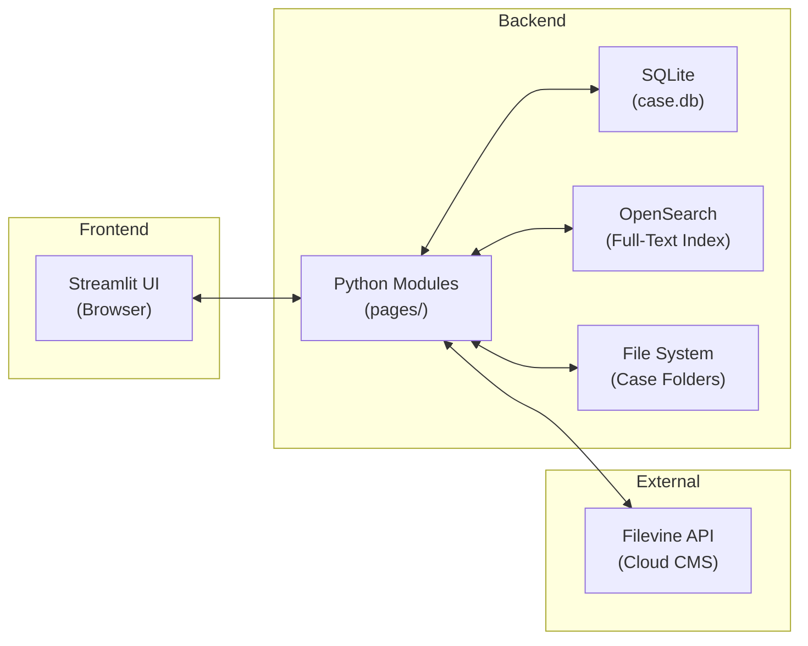
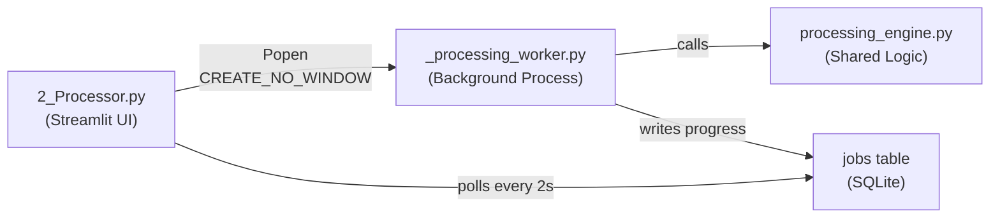
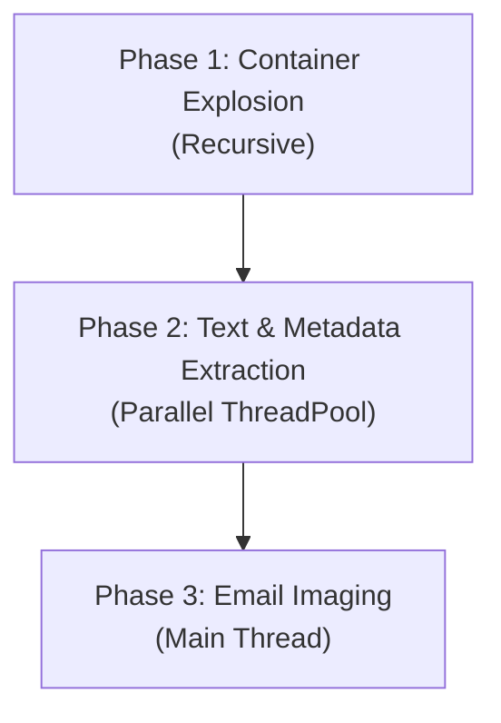

# Respondeo — Technical Overview

> **Document Classification:** Internal Engineering Reference
> **Platform Version:** Beta 2.15 (May 2026)
> **Author:** Respondeo maintainer
>
> **Recent Updates (Beta 2.15):** Container-family model rewritten so emails extracted from PST/ZIP archives root families at the email envelope rather than the container (C4, lesson `docs/lessons/container-family-model.md`). EML attachment Content-ID over-skip defect fixed via shared `is_part_inline_image()` predicate consumed by both extraction (`container_exploder._explode_eml`) and rendering (`universal_imager.convert_eml_to_pdf`) — lesson `docs/lessons/extraction-rendering-symmetry.md`.

---

## Architecture

The platform is a Python **Streamlit** web application consisting of a central `home.py` entry point and individual page modules under `pages/`. Data persistence uses **SQLite** for structured document metadata and **OpenSearch** for full-text search indexing. File-based storage follows a strict folder hierarchy per case.



### Case Folder Structure

```
{CASES_ROOT}/{CaseName}/
├── Ingest/                 # Raw native files (never modified after ingestion)
├── Temp_Explode/           # Transient: attachment extraction workspace
├── Processed/              # Control-numbered files + imaged PDFs
├── Reviewed/               # Filevine pull-back PDFs with redaction annotations
├── Inbound/                # Opposing counsel productions
│   └── {Party}/{Volume}/   # Isolated per party per production
├── Produced/               # Final production output (Bates-stamped)
│   ├── IMAGES/             # PDF or TIFF images
│   ├── NATIVES/            # Native file copies
│   └── TEXT/               # Extracted text per document
├── Audit/                  # Processing logs, batch reports
├── Hold_Documents/         # Legal hold admin records (NOT case ESI)
│   └── {CustodianName}/    # One subfolder per custodian
└── case.db                 # SQLite database
```

### Key Modules

| File | Role |
|------|------|
| `home.py` | Case selector, service status, session init, User Management (Admin), Audit Log Viewer (Admin), Matter Profile, Case Archive, Issue Coding Fields, De-NIST Config, Hash Integrity Verification |
| `config.py` | Service endpoints, tool paths, Filevine config |
| `db_manager.py` | SQLite connection factory, schema auto-migration, `log_audit()`, `log_audit_batch()` |
| `os_manager.py` | OpenSearch client factory (local, no-auth); `scan_all()` scroll/scan utility |
| `auth_manager.py` | YAML-based login, permission-based RBAC with custom roles, user CRUD, document visibility |
| `ui_utils.py` | Global CSS injection, autocomplete suppression, overlay cancel button for long-running operations |
| `container_exploder.py` | MSG/ZIP/RAR/PST extraction engine; dual-path PST support (libpff primary, Outlook COM fallback); MAPI record set helpers; magic byte detection |
| `email_imager.py` | Legacy email imager (partially superseded by `universal_imager.py`) |
| `universal_imager.py` | Master imaging router (EML via stdlib, MSG via olefile, Office COM, PyMuPDF, images, text); structured email metadata extraction (`extract_msg_metadata()`, `extract_eml_metadata()`) |
| `pdf_exporter.py` | Mass PDF export utility — builds ZIP archives of PDFs from the Review bulk action bar |
| `8_Exhibits.py` | Exhibit List / Trial Binder management — set CRUD, exhibit list with reorder/remove, binder PDF export |

### Documentation Architecture (`docs/`)

Four-tier reference system installed in beta-2.11 (Commits 6b–6e):

| Tier | Purpose |
|------|---------|
| `docs/references/` | Dependency API references (PyMuPDF, libpff, Outlook COM, Tika, OpenSearch, MIME) — consult before writing code against these libraries. |
| `docs/lessons/` | Durable patterns and gotchas extracted from sprint retrospectives — consult before writing code that resembles a past footgun. |
| `docs/templates/` | Reusable workflow templates (preflight, defect-triage, scoped-audit) — reach for these instead of reinventing structure. |
| `docs/archive/` | Forensic preservation of completed/superseded work (shipped specs, retired prompts, per-sprint sources). |

Each directory has a `README.md` index. The authoritative cross-reference table lives in `CLAUDE.md` under §Dependency API References; consult that table when you need to find a specific file by purpose.

---

## Authentication & Permission-Based Access Control

### Permission-Based RBAC

Access control uses named permissions rather than a numeric role hierarchy. Each user is assigned a role, and each role maps to a set of granular permissions. The `has_permission(permission_name)` and `require_permission(permission_name)` functions enforce access gates throughout the platform. All gates are annotated with `# permission: <name>` comments for auditability.

Roles and permissions are stored in `auth_config.yaml` alongside the `bcrypt` password hash (work factor 12). Legacy SHA-256 credentials from earlier beta versions are automatically detected and transparently migrated to bcrypt upon the user's next successful login.

### Default Roles & Permissions

| Permission | Admin | Manager | Reviewer | Expert |
|---|---|---|---|---|
| `ingest` | ✅ | ✅ | | |
| `process` | ✅ | ✅ | | |
| `analytics` | ✅ | ✅ | | |
| `review` | ✅ | ✅ | ✅ | ✅ |
| `tag` | ✅ | ✅ | ✅ | ✅ |
| `redact` | ✅ | ✅ | ✅ | |
| `export_csv` | ✅ | ✅ | | |
| `export_pdf` | ✅ | ✅ | | |
| `str_run` | ✅ | ✅ | | ✅ |
| `str_export` | ✅ | ✅ | | |
| `production` | ✅ | ✅ | | |
| `inbound_production` | ✅ | ✅ | | |
| `privilege_log` | ✅ | ✅ | | |
| `sync` | ✅ | ✅ | | |
| `case_settings` | ✅ | ✅ | | |
| `column_picker` | ✅ | ✅ | | |
| `user_admin` | ✅ | | | |
| `audit_view` | ✅ | | | |
| `saved_search_global` | ✅ | ✅ | | |
| `saved_search_personal` | ✅ | ✅ | ✅ | ✅ |
| `download_produced` | ✅ | ✅ | ✅ | ✅ |
| `mark_exhibit` | ✅ | ✅ | ✅ | |
| `view_exhibits` | ✅ | ✅ | ✅ | |
| `manage_exhibit_sets` | ✅ | ✅ | | |
| `manage_exhibits` | ✅ | ✅ | | |
| `export_exhibit_binder` | ✅ | ✅ | | |
| `split_document` | ✅ | ✅ | | |
| `trim_document` | ✅ | ✅ | | |
| `view_shell_documents` | ✅ | ✅ | | |

**Admin** has wildcard (`*`) access — all permissions granted implicitly.

**Expert Reviewer** is a built-in custom role with limited review capabilities: search, tag, STR run, personal saved searches, and produced document download — but no export, redaction, or column picker access.

### Custom Roles

Admins can create custom roles via the User Management UI. Custom roles are defined in `auth_config.yaml` under `custom_roles` and support:
- `inherits` — base role whose permissions are inherited
- `additional` — list of extra permissions added on top

### Document Visibility

Three visibility modes configurable per user (Admin manages via User Management):

| Mode | Behavior |
|---|---|
| `full` | All documents visible (default) |
| `produced_only` | Only documents with a `begdoc` Bates number are visible |
| `hidden_tags` | Documents matching configured tag patterns are hidden |

Admin users always have full visibility regardless of setting. Visibility filters are applied as SQL `WHERE` clauses in the Review grid.

### Session Timeout

Configurable inactivity auto-logout. The `session_timeout_minutes` key in `auth_config.yaml` (default 30) sets the threshold. On each authenticated page load, `auth_manager` compares the current time against `st.session_state['_last_activity']`. If the delta exceeds the configured timeout, all auth session keys (`authenticated`, `username`, `user_role`, `display_name`) are cleared and the user sees a warning to re-login. Setting `session_timeout_minutes` to `0` disables the timeout entirely.

### Module Visibility

Pages are hidden entirely from the sidebar if the user lacks the required permission (via `has_permission()` checks in the navigation builder), rather than shown with a blocking error message.

| Module | Required Permission | Notes |
|---|---|---|
| `home.py` | *(any role)* | User Management section gated to `user_admin`; Audit Log gated to `audit_view` |
| `1_Ingestor.py` | `ingest` | |
| `2_Processor.py` | `process` | |
| `3_Analytics.py` | `analytics` | |
| `4_Review.py` | `review` | Sub-features individually gated: `export_csv`, `column_picker`, `export_pdf`, `str_run`, `str_export`, `redact`, `split_document`, `trim_document`, `view_shell_documents` |
| `5_Production.py` | `production` | Tabs: outbound production, privilege log (inbound extracted to Module 9 in beta-2.10 Commit 6) |
| `9_InboundProduction.py` | `production` | Dedicated module for opposing-counsel production ingestion; extracted from `5_Production.py` tab_inbound in beta-2.10 Commit 6 |
| `6_Sync.py` | `sync` | |
| `7_Custodians.py` | `custodian_management` | Sub-tab: `collection_scope` |
| `8_Exhibits.py` | `view_exhibits` | Sub-features: `manage_exhibit_sets`, `manage_exhibits`, `mark_exhibit`, `export_exhibit_binder` |

### Sidebar Badges

- 👑 Admin
- 🏢 Manager
- 📋 Reviewer
- 🔍 Expert

### Sidebar Navigation Registry (`_NAV_PAGES`)

The sidebar is built from the `_NAV_PAGES` list in `auth_manager.py` — a tuple registry of `(file_path, label, permission_required)`. `auth_manager.show_user_info()` iterates the registry and renders each page link guarded by `has_permission(permission_required)`. Pages not in the registry are NOT reachable from the sidebar even if their file exists on disk (a user can still reach an orphan page via direct URL if the auth gate passes, but they cannot discover it). The contract is pinned by `tests/test_nav_registry_consistency.py` which asserts every `pages/*.py` has a tuple and vice-versa. Post-sprint audit protocol (CLAUDE.md §Post-Sprint step 6, added beta-2.10 Commit 8) includes a nav-registry reconciliation step after the 7.7 gap where Module 9 was registered only after the next commit.

---

## Case Lifecycle Management

The `db_manager.get_case_status()` function maintains a distinct lifecycle state for every case matter (e.g., `Active`, `Archived`, `Processing`).
- This state is managed via an administrator control in the `home.py` dashboard.
- Transitioning a case state broadcasts a `CASE_SETTING_CHANGED` audit event.
- It provides a centralized gate, allowing upstream logic to disable ingest or production for `Archived` matters, preventing accidental mutation of closed cases.

### Matter Profile (`home.py`)

A 10-field metadata card displayed on the case dashboard when a case is selected. Fields include case caption, matter number, client name, opposing counsel, court, judge, jurisdiction, case type, matter description, and notes. Stored as a JSON blob in `case_settings` via `get_matter_profile()` / `set_matter_profile()`. An "Edit Matter Profile" expander provides inline editing. The profile is included in the Case Archive manifest.

### Case Archive (`home.py`)

Admin-level case export that generates a ZIP archive containing:
- `MANIFEST.json` — case metadata (matter profile, case settings, generation timestamp, document counts)
- `case.db` — full SQLite database copy
- All produced documents from the `Produced/` folder hierarchy

Generated via the "Generate Case Archive" button (gated: Admin). The resulting ZIP is offered as a `st.download_button`.

### Issue Coding Field Management (`home.py`)

Admin UI for creating and managing custom issue coding fields. Supports three field types: `picklist` (with configurable option list), `text`, and `boolean`. Fields are stored in the `coding_fields` table and rendered in the Review coding panel. Reorder via display_order, delete cascades to `document_coding` entries.

### De-NIST Filter Configuration (`home.py`)

Case Maintenance section for configuring which file extensions are excluded by the NIST de-NISTing filter during processing. `DEFAULT_NIST_EXTENSIONS` constant in `db_manager.py` provides the baseline list (`.dll`, `.exe`, `.sys`, etc.). Per-case overrides stored in `case_settings` via `get_nist_extensions()` / `set_nist_extensions()`. UI provides edit, save, and reset-to-defaults controls. The Processor reads the active list at runtime.

### Hash Integrity Verification (`home.py`)

Case Maintenance utility that re-hashes all processed files and compares against stored `md5_hash` values. Flags mismatches (file modified since ingestion) and missing files (expected but not found on disk). Results displayed in a summary table with per-document status.

---

## Database Schema

The SQLite database (`case.db`) uses a single `documents` table plus supporting tables. Columns are auto-migrated via `init_db()` using `ALTER TABLE ... ADD COLUMN` wrapped in try/except — idempotent and safe on existing databases.

### `documents` Table (key columns)

| Column | Type | Purpose |
|--------|------|---------|
| `control_number` | TEXT | `DOC-{id:06d}` for internal; original CN for inbound |
| `begdoc`, `enddoc` | TEXT | Production Bates range |
| `begatt`, `endatt` | TEXT | Family Bates range |
| `parent_id` | TEXT | Parent control number (container extraction families and split/trim lineage) |
| `group_id` | TEXT | Family/thread group ID |
| `file_name` | TEXT | Original filename |
| `file_extension` | TEXT | Lowercase extension |
| `file_size_kb` | REAL | Size in kilobytes |
| `md5_hash` | TEXT | MD5 fingerprint (exact dedup) |
| `content_hash` | TEXT | SHA-256 of extracted text (near-dupe) |
| `record_type` | TEXT | `Email`, `Document`, `Attachment` |
| `processing_status` | TEXT | `New`, `Master`, `Duplicate (MD5)`, `Error`, `Thread-Suppressed`, `NearDupe-Suppressed`, `Container_Scanned`, `Ready_For_Processing`, `Split_Source` |
| `split_page_ranges` | TEXT | JSON recording which pages were extracted during split/trim (stored on child documents) |
| `custodian` | TEXT | Source custodian |
| `source_party` | TEXT | `Internal` or opposing party name |
| `production_volume` | TEXT | Volume label for inbound |
| `email_from/to/cc/bcc` | TEXT | Parsed email headers (full SMTP addresses where available) |
| `email_subject` | TEXT | Subject line |
| `message_id`, `in_reply_to` | TEXT | RFC 2822 threading fields |
| `references_list` | TEXT | RFC 2822 References chain (semicolon-delimited) |
| `conversation_index` | TEXT | Outlook conversation index (hex-encoded) |
| `conversation_topic` | TEXT | Normalized subject for threading (MSG OLE stream `0070`) |
| `date_sent`, `date_created`, `date_modified` | TEXT | ISO 8601 dates |
| `date_received` | TEXT | ISO 8601 date received |
| `author` | TEXT | Document author |
| `title` | TEXT | Document title (dc:title from Tika) |
| `mime_type` | TEXT | Content-Type detected by Tika |
| `creating_application` | TEXT | Application name + version that created the document |
| `extraction_method` | TEXT | How text was obtained: `pymupdf` / `tika` / `tesseract_ocr` / `native_ole` |
| `is_encrypted` | INTEGER | 1 if PDF/Office file is password-protected |
| `word_count` | INTEGER | Word count from Tika |
| `page_count` | INTEGER | Page count (from Tika) |
| `attachment_count` | INTEGER | Number of child attachments |
| `importance` | TEXT | Email priority: Low / Normal / High |
| `sensitivity` | TEXT | Email sensitivity: Normal / Personal / Private / Confidential |
| `language` | TEXT | Detected language (from Tika) |
| `tika_metadata_json` | TEXT | Full raw Tika metadata dict as JSON |
| `tags` | TEXT | Semicolon-delimited tags |
| `redaction_status` | TEXT | `None` or `Has Redactions` |
| `clawback_status` | TEXT | `None`, `Clawback_Demanded` |
| `clawback_date` | TEXT | ISO 8601 date of clawback demand |
| `filevine_doc_id` | TEXT | Filevine document ID after sync |
| `byos_pushed_at` | TEXT | Timestamp of BYOS sync push |
| `dynamic_metadata` | TEXT | JSON blob for unmapped inbound load file columns |

### `document_productions` Table

Junction table for multi-production tracking. Replaces the flat `begdoc`/`enddoc` columns on `documents` for production history. Backfilled from existing flat columns on first migration via `INSERT OR IGNORE`.

| Column | Type | Purpose |
|--------|------|---------|
| `id` | INTEGER PK | Auto-increment |
| `control_number` | TEXT | Document control number |
| `production_volume` | TEXT | Volume label (e.g., `VOL001`) |
| `begdoc` | TEXT | Beginning Bates number |
| `enddoc` | TEXT | Ending Bates number |
| `page_count` | INTEGER | Pages in this production |
| `produced_at` | DATETIME | Timestamp of production |
| `production_type` | TEXT | `Original`, `Supplemental`, or `Replacement` |
| `supersedes_id` | INTEGER FK | Self-referential FK to the row this replaces (for `Replacement` type) |
| `notes` | TEXT | Free-text production notes |

Unique constraint: `UNIQUE(control_number, production_volume)`. Indexes: `idx_dp_control_number`, `idx_dp_production_volume`, `idx_dp_begdoc`.

### `exhibit_sets` Table

Exhibit set / trial binder container.

| Column | Type | Purpose |
|--------|------|---------|
| `id` | INTEGER PK | Auto-increment |
| `case_folder` | TEXT | Case association |
| `set_name` | TEXT | Display name (e.g., "Smith Deposition") |
| `set_type` | TEXT | `Deposition`, `Motion`, `Hearing`, or `Trial` |
| `proceeding_date` | TEXT | ISO 8601 date of the proceeding |
| `case_caption` | TEXT | Case caption for binder cover page |
| `created_by` | TEXT | Username |
| `created_at` | DATETIME | Timestamp |

Unique constraint: `UNIQUE(case_folder, set_name)`.

### `exhibits` Table

Individual exhibit entries within an exhibit set.

| Column | Type | Purpose |
|--------|------|---------|
| `id` | INTEGER PK | Auto-increment |
| `exhibit_set_id` | INTEGER FK | References `exhibit_sets(id)` with `ON DELETE CASCADE` |
| `control_number` | TEXT FK | References `documents(control_number)` |
| `exhibit_number` | TEXT | Freeform exhibit number (e.g., "1", "A", "1A") |
| `description` | TEXT | Exhibit description |
| `sort_order` | INTEGER | Display ordering |
| `added_by` | TEXT | Username |
| `added_at` | DATETIME | Timestamp |

Unique constraints: `UNIQUE(exhibit_set_id, exhibit_number)`, `UNIQUE(exhibit_set_id, control_number)`. Indexes: `idx_exhibits_set_id`, `idx_exhibits_cn`.

### `collection_scope` Table

Per-custodian per-source collection status tracking with justification text.

| Column | Type | Purpose |
|--------|------|---------|
| `id` | INTEGER PK | Auto-increment |
| `custodian_id` | INTEGER FK | References `custodians(id)` |
| `source_name` | TEXT | Data source name |
| `status` | TEXT | `Collected`, `Searched-No-Hit`, `Not-Reasonably-Accessible`, or `Out-of-Scope` |
| `justification` | TEXT | Free-text justification for the status |
| `updated_at` | DATETIME | Last modified timestamp |

4 CRUD functions in `db_manager.py`: `get_collection_scope()`, `upsert_collection_scope()`, `get_all_collection_scope()`, `seed_collection_scope()`.

### `coding_fields` & `document_coding` Tables

Custom issue coding fields for attorney work product. `coding_fields` stores field definitions; `document_coding` stores per-document values.

**`coding_fields`:**

| Column | Type | Purpose |
|--------|------|---------|
| `id` | INTEGER PK | Auto-increment |
| `field_name` | TEXT UNIQUE | Display name |
| `field_type` | TEXT | `picklist`, `text`, or `boolean` |
| `pick_list_json` | TEXT | JSON array of options (for picklist type) |
| `display_order` | INTEGER | Sort order in UI |
| `created_by` | TEXT | Username |
| `created_at` | DATETIME | Timestamp |

**`document_coding`:**

| Column | Type | Purpose |
|--------|------|---------|
| `id` | INTEGER PK | Auto-increment |
| `control_number` | TEXT FK | Document reference |
| `coding_field_id` | INTEGER FK | References `coding_fields(id)` |
| `field_value` | TEXT | Stored value |
| `coded_by` | TEXT | Username |
| `coded_at` | DATETIME | Timestamp |

Unique constraint: `UNIQUE(control_number, coding_field_id)`. Indexes: `idx_dc_control_number`, `idx_dc_field_id`. 7 CRUD functions in `db_manager.py`: `get_coding_fields()`, `create_coding_field()`, `delete_coding_field()`, `get_document_coding()`, `set_document_coding()`, `get_all_coding_for_documents()`, `update_coding_field_order()`.

### `document_notes` Table

Per-user per-document reviewer notes.

| Column | Type | Purpose |
|--------|------|---------|
| `control_number` | TEXT | Document reference |
| `username` | TEXT | Note author |
| `note_text` | TEXT | Note content |
| `created_at` | DATETIME | Original creation time |
| `updated_at` | DATETIME | Last edit time |

Unique constraint: `UNIQUE(control_number, username)` (one note per user per document). 4 CRUD helpers in `db_manager.py`: `get_document_notes()`, `get_user_note()`, `upsert_document_note()`, `delete_document_note()`.

### `saved_searches` Table

Stores per-user, per-case search history and named saves.

| Column | Type | Purpose |
|--------|------|---------|
| `id` | INTEGER PK | Auto-increment |
| `username` | TEXT | Owner (from session state) |
| `search_name` | TEXT | Display name (NULL for recent entries) |
| `query` | TEXT | Full search query string |
| `col_filters_json` | TEXT | JSON of active column filters |
| `is_recent` | INTEGER | 1 = auto-logged, 0 = named save |
| `created_at` | DATETIME | Timestamp |

Recent history rotates at 10 entries per user. Named saves are unlimited.

### `jobs` Table

Tracks background processing tasks for the Processor module status display. Each row represents one processing run.

| Column | Type | Purpose |
|--------|------|---------|
| `id` | INTEGER PK | Auto-increment |
| `job_type` | TEXT | Job category (e.g., `processing`) |
| `status` | TEXT | Lifecycle state: `pending` → `running` → `completed` / `failed` / `cancelled` |
| `created_at` | DATETIME | When the job was created |
| `started_at` | DATETIME | When the worker began execution |
| `finished_at` | DATETIME | When the job ended (success, failure, or cancel) |
| `progress` | INTEGER | Current item count within the active phase |
| `total` | INTEGER | Total items for the active phase (0 during Phase 1 recursive extraction) |
| `error` | TEXT | Error message if status is `failed` |
| `phase` | INTEGER | Active phase number (1, 2, or 3) |
| `phase_label` | TEXT | Human-readable status message for the UI |
| `details_json` | TEXT | JSON blob: per-phase stats, recent warnings, thread config |
| `pid` | INTEGER | OS process ID of the background worker (used for zombie detection) |
| `case_folder` | TEXT | Case folder path (for multi-case conflict detection) |
| `username` | TEXT | User who launched the job |
| `cancel_requested` | INTEGER | Set to 1 when the user clicks Cancel; worker polls this flag |

**Job lifecycle:** `pending` (created by UI) → `running` (worker registers PID) → `completed` / `failed` / `cancelled`. The UI polls the job row every 2 seconds to update the progress monitor. Zombie detection uses `GetExitCodeProcess` on Windows — if the PID is no longer alive but the status is `running`, the job is treated as failed.

### `redaction_marks` Table

| Column | Type | Purpose |
|--------|------|---------|
| `control_number` | TEXT | Document the marks belong to |
| `page_number` | INTEGER | Page index (0-based) |
| `marks_json` | TEXT | JSON array of `{pdf_x0, pdf_y0, pdf_x1, pdf_y1, reason}` objects |

Unique constraint on `(control_number, page_number)` — one row per page per document. Coordinates are in PDF points (not screen pixels); the scale factor from the canvas is applied at draw time.

### `audit_log` Table

Full schema (created in `init_db()`, columns added via `ALTER TABLE ADD COLUMN` migration):

```sql
CREATE TABLE IF NOT EXISTS audit_log (
    id INTEGER PRIMARY KEY AUTOINCREMENT,
    timestamp DATETIME DEFAULT CURRENT_TIMESTAMP,
    action TEXT,          -- Standardized verb (see vocabulary below)
    details TEXT,         -- Free-text / JSON context
    username TEXT,        -- Logged-in user who performed the action
    control_number TEXT,  -- Document affected (NULL for case-level actions)
    module TEXT,          -- Page/module where action originated
    old_value TEXT,       -- State before the change (NULL for creates)
    new_value TEXT        -- State after the change (NULL for deletes)
)
```

Indexes: `idx_audit_control (control_number)`, `idx_audit_user (username)`, `idx_audit_timestamp (timestamp)`, `idx_audit_module (module)`.

**Standard action vocabulary** (all modules use these exact strings):

`DOCUMENT_INGESTED` | `PROCESSING_STARTED` | `PROCESSING_COMPLETED` | `PROCESSING_ERROR` | `PROCESSING_CANCELLED` | `TEXT_EXTRACTED` | `DOCUMENT_IMAGED` | `DUPLICATE_MARKED` | `ANALYTICS_RUN` | `TAG_APPLIED` | `TAG_REMOVED` | `TAGS_CHANGED` | `COMMENT_ADDED` | `COMMENT_EDITED` | `SEARCH_EXECUTED` | `SEARCH_SAVED` | `PDF_EXPORTED` | `PRODUCED_DOWNLOAD` | `REDACTION_SAVED` | `REDACTION_CLEARED` | `PRODUCTION_CREATED` | `PRODUCTION_CANCELLED` | `BATES_ASSIGNED` | `REDACTION_BURNED` | `PRODUCTION_EXPORTED` | `INBOUND_INGESTED` | `PRIVILEGE_LOG_EXPORTED` | `USER_LOGIN` | `USER_CREATED` | `USER_ROLE_CHANGED` | `CASE_SETTING_CHANGED` | `FILEVINE_PUSH` | `FILEVINE_PULL`

---

## Audit Trail Architecture

### Central Logging Functions (`db_manager.py`)

All audit logging flows through two functions in `db_manager.py`. Neither function ever raises — audit failures must never crash workflows.

```python
log_audit(case_folder, action, username, control_number, module,
          details=None, old_value=None, new_value=None)
# Single-row INSERT into audit_log. Called from interactive UI handlers.

log_audit_batch(case_folder, entries)
# executemany() in a single transaction. Called from high-volume operations
# (Ingestor, Analytics batch runs, Production, InboundProd).
```

### Writer-Thread Safety in the Processor

The Processor runs Phase 2 text extraction in a `ThreadPoolExecutor`. SQLite cannot be safely written from multiple threads concurrently. The Processor uses a dedicated `db_writer_worker` queue thread that drains database writes serially. Audit events generated by worker threads are posted to this queue as special `('audit', entry_dict)` tuples alongside normal document update tuples. The writer thread dispatches them to `log_audit()` in the correct serialized order. This is the same pattern used for all SQLite writes from the Processor thread pool.

### Module Coverage

All 12 modules are wired to the audit trail:

| Module | Key Events Logged |
|--------|-------------------|
| `home.py` | `USER_LOGIN`, `USER_CREATED`, `USER_ROLE_CHANGED`, `CASE_SETTING_CHANGED` |
| `1_Ingestor.py` | `DOCUMENT_INGESTED` (batch via `log_audit_batch`) |
| `2_Processor.py` | `PROCESSING_STARTED`, `PROCESSING_COMPLETED`, `PROCESSING_ERROR`, `PROCESSING_CANCELLED`, `TEXT_EXTRACTED`, `DOCUMENT_IMAGED`, `DUPLICATE_MARKED` (writer-thread-safe) |
| `3_Analytics.py` | `ANALYTICS_RUN`, `TAGS_CHANGED` (batch) |
| `4_Review.py` | `TAG_APPLIED`, `TAG_REMOVED`, `TAGS_CHANGED`, `COMMENT_ADDED`, `COMMENT_EDITED`, `SEARCH_EXECUTED`, `SEARCH_SAVED`, `PDF_EXPORTED`, `PRODUCED_DOWNLOAD` |
| `5_Production.py` | `PRODUCTION_CREATED`, `PRODUCTION_CANCELLED`, `PRODUCTION_RETRY`, `PRODUCTION_STALE_CLEANUP`, `BATES_ASSIGNED`, `REDACTION_BURNED`, `PRODUCTION_EXPORTED`, `INBOUND_INGESTED` (batch), `PRIVILEGE_LOG_EXPORTED` |
| `6_Sync.py` | `FILEVINE_PUSH`, `FILEVINE_PULL` |
| `4_Review.py` (📊 STR view) | `SEARCH_EXECUTED` |
| `4_Review.py` (✏️ Redact tab) | `REDACTION_SAVED`, `REDACTION_CLEARED` |

### Audit Log Viewer

Admin-only expander on `home.py`, visible only when a case is selected. Filters: username, module, action, control number, date range. Returns up to 2,000 rows ordered `timestamp DESC`. Includes `st.download_button` CSV export.

---

## In-Browser Redaction — ✏️ Redact Tab (`4_Review.py`)

> `10_Redaction.py` was deleted in v2.3. Redaction is now the fourth tab inside `4_Review.py`, accessible to all Reviewer+ roles. This keeps attorneys in the Review module without losing their grid position.

### Architecture

Two-column layout: **control panel (30%) | canvas (70%)**.

- **Control panel (left):** Status badge, page navigation bar (◀ text_input / N ▶), Draw/Select radio, per-box privilege reason selectors, Save/Clear action buttons.
- **Canvas (right):** `streamlit-drawable-canvas` with the rendered PDF page as background.
- **Canvas initialization:** A per-document checkbox (`🖊️ Load Redaction Canvas`) gates the canvas render. The user clicks it once per document; the checkbox key is `enable_redact_{control_number}` (no page index), so it persists across page navigation within the same document. This is required because `st_canvas` is a React component that does not reliably display its background image on the very first mount without a user-triggered rerun.

**Canvas rendering:**
- `fitz.open(pdf_path)` → `page.get_pixmap(matrix=fitz.Matrix(dpi/72, dpi/72))` at ~105 DPI (target 1000px width) → PNG bytes → PIL Image stored in `st.session_state[f"_redact_bg_{cn}_{page_idx}"]`
- `streamlit-drawable-canvas` receives the PIL Image via `background_image=`
- Canvas key: `redact_canvas_{control_number}_{page_index}` — forces re-mount on document/page change
- Canvas renders first in code execution order (inside `with _r_canvas_col:`) so `_r_canvas_result` is available when the control panel renders afterward (inside `with _r_ctrl_col:`)

**Coordinate math (canvas px → PDF pt):**
```python
scale_x = pdf_page.rect.width / canvas_width_px
scale_y = pdf_page.rect.height / canvas_height_px
pdf_rect = fitz.Rect(
    obj["left"] * scale_x,
    obj["top"] * scale_y,
    (obj["left"] + obj["width"]) * scale_x,
    (obj["top"] + obj["height"]) * scale_y
)
```

**Canvas mode timing:** `canvas_mode` must be read from `st.session_state` before `st_canvas()` is called (it holds the **previous** rerun's value), because the radio widget that controls it renders in the control panel after the canvas renders.

### Persistence — `redaction_marks` Table

On **💾 Save Marks:**
1. Build mark list from canvas `objects` — each object carries `left`, `top`, `width`, `height`, and the associated reason from the reasons panel.
2. Convert canvas coordinates to PDF points.
3. Write `marks_json` to `redaction_marks` table (upsert by `control_number + page_number`).
4. Open the PDF, call `page.add_redact_annot(pdf_rect, fill=(0,0,0))` for each mark, save with `doc.saveIncr()`.
5. `apply_redactions()` is **NOT called** — content destruction is reserved for the Production burn step.
6. Call `_sync_document_tags()` — derives authoritative privilege tag set from all pages' marks in DB, replaces `documents.tags` privilege subset exactly.
7. Log `REDACTION_SAVED` to audit trail.

On **🗑 Clear This Page / 🗑🗑 Clear All Pages:**
1. Delete mark row(s) from `redaction_marks`.
2. Open PDF, remove `PDF_ANNOT_REDACT` annotations from affected pages, save with `doc.saveIncr()`.
3. Call `_sync_document_tags()` — orphaned privilege tags are removed.
4. Log `REDACTION_CLEARED` to audit trail.

### Tag Sync (`_sync_document_tags()`)

```python
def _sync_document_tags(case_folder, control_number):
    # 1. Query all redaction_marks rows for this document
    # 2. Collect unique reasons across all pages
    # 3. Load current tags from documents table
    # 4. Remove all privilege-category tags from current tag set
    # 5. Add the collected reasons (which are privilege tag names) back
    # 6. Write the merged tag set back to documents.tags
```

This ensures `documents.tags` privilege subset always exactly reflects the current redaction mark reasons — no orphaned privilege tags can persist after marks are removed.

### Windows File Lock Constraint

`fitz.open()` holds an exclusive OS-level lock on Windows. The canvas rendering pass opens and closes the PDF. The save pass opens it again. Any code path that opens the PDF for rendering must explicitly call `doc.close()` before a save handler tries to open the same file. This is enforced throughout the module with explicit `close()` calls.

---

## Data Ingestion (`1_Ingestor.py`)

### Enhanced UI (Beta 2)

- Case statistics header (total ingested, processed, unprocessed)
- Interactive folder preview with file type and size breakdown
- Two-column settings layout (scan folder, custodian, thread count)
- Step-by-step progress with live status updates
- Post-scan results card

### Process

1. User selects scan folder, enters **custodian name** (required)
2. Multi-threaded `ThreadPoolExecutor` walks the directory tree
3. Each file: compute MD5 hash, record size, extension, original path
4. Idempotent `INSERT OR IGNORE` on `original_path` — re-runs skip existing files
5. System folders (`Processed/`, `Produced/`, `Temp_Explode/`, `Inbound/`) auto-excluded

---

## Document Processing (`2_Processor.py` + `processing_engine.py`)

### Background Worker Architecture

Processing runs as a **detached subprocess** (`_processing_worker.py`) that survives Streamlit session disconnects, browser closes, and WebSocket drops. The architecture follows the same subprocess isolation pattern used for PST extraction (`_pst_worker.py`).



- **`processing_engine.py`** — All processing logic extracted from `2_Processor.py` (no Streamlit imports). Callback-based progress reporting via `on_progress(phase, completed, total, message)` and `check_cancel()` functions.
- **`_processing_worker.py`** — Standalone entry point launched via `subprocess.Popen` with `CREATE_NO_WINDOW | CREATE_NEW_PROCESS_GROUP` flags. Reads the `jobs` table for configuration, calls `processing_engine` phase functions, writes progress back to the `jobs` table.
- **`2_Processor.py`** — UI layer: creates a job row, launches the worker subprocess, then displays the job monitor (polling the `jobs` table every 2 seconds). If the subprocess launch fails, falls back to inline execution.

**SQLite contention handling:** The worker calls `conn.commit()` before every `log_audit()` call to release the write lock — `log_audit()` opens a separate connection, and SQLite allows only one writer at a time. Job CRUD functions use a retry-once pattern for `SQLITE_BUSY`.

### Enhanced UI (Beta 2)

- Dashboard showing queue stats and file type breakdowns before run
- Phase cards visually representing the pipeline (Container Extraction → Text Extraction → Email Imaging)
- Dynamic colored status banners during run (replacing generic spinners)
- Improved post-run summary and retry/backfill controls
- **Job Monitor** — live progress panel with phase-colored banners, progress bar, warning expander, and cancel button. Auto-refreshes every 2 seconds by polling the `jobs` table.

### Pipeline



### Phase 1: Container Explosion

Iteratively: scan for `processing_status = 'New'` containers → extract children → register in DB → repeat until none remain. Container parents are promoted to `Container_Scanned` after extraction (Phase 2 skips these; the Review grid excludes them from display).

| Container | Method |
|-----------|--------|
| `.msg` | `container_exploder.py` → `process_msg_batch()` via `win32com.client` Outlook MAPI COM, sequential. Synthetic CID generation for inline-flagged attachments (PR_ATTACH_FLAGS bit 2) that lack a Content-ID prevents signature images from leaking as child documents. |
| `.zip` / `.rar` | Python `zipfile` / `rarfile`, parallel |
| `.eml` | Python `email` stdlib attachment extraction; CID inline images explicitly skipped (already embedded in parent PDF). Magic byte detection (`_guess_ext_from_magic()`) resolves `.bin` attachments to their real extension. |
| `.pst` | `explode_pst()` in `container_exploder.py` — **dual-path extraction**: primary via Outlook COM (`_explode_pst_com()`), automatic fallback to libpff-python (`explode_pst_libpff()`) when COM is unavailable. COM path mounts PST via `namespace.AddStore()`, walks folders recursively, saves messages as `.msg`. libpff path uses `pypff` to extract messages as `.eml` files, with MAPI record set helpers (`_get_record_entry()`, `_get_record_string()`, `_get_record_integer()`) for structured metadata access. |

**Container lifecycle:** `New` → `Container_Scanned` (after child extraction) → skipped by Phase 2 → excluded from Review grid. Children enter the pipeline as `New` documents.

**Long-path handling:** All file paths are prefixed with `\\?\` on Windows to bypass the 260-character MAX_PATH limit. Prefixes are stripped before DB storage and COM calls via `_strip_long_path_prefix()`.

### Phase 2: Text Extraction & Indexing (`process_file_worker`)

1. MD5 dedup check against `ThreadSafeSet`
2. Apache Tika `tika.parser.from_file()` → text + metadata (including `page_count`, `language`). List-valued metadata fields are unwrapped to their first element before storage. Full Tika metadata dict stored as JSON in `tika_metadata_json`.
3. **Metadata enrichment** — populates all enrichment columns: `title`, `mime_type`, `creating_application`, `word_count`, `is_encrypted`, `importance`, `sensitivity`, `conversation_topic`, `attachment_count`. Tracks `extraction_method` (`tika` / `pymupdf` / `tesseract_ocr` / `native_ole`).
4. **Native email metadata override** — for `.msg`/`.eml` files, `extract_msg_metadata()` / `extract_eml_metadata()` from `universal_imager.py` provide authoritative values for email headers (`from`, `to`, `cc`, `bcc`, `subject`, `message_id`, `in_reply_to`, `references`), overriding Tika's less reliable parsing.
5. **OCR fallback** — if Tika returns no text (`has_text = 0`): PyMuPDF renders each page to an image via `page.get_pixmap()`, `pytesseract.image_to_string()` extracts text, result is indexed to OpenSearch. Path read from `config.py` as `TESSERACT_PATH`. The Processor status panel shows "Tesseract OCR: Available" or a warning if not installed.
6. SHA-256 content hash for near-dupe detection
7. Junk image tagging (< 30KB or < 150×150px)
8. OpenSearch bulk indexing via `db_writer_worker` queue thread (also drains audit events posted as `('audit', entry_dict)` tuples)
9. File relocation to `Processed/{control_number}{ext}`

**Cancel button:** An overlay cancel button (injected via `ui_utils.show_overlay_cancel_button()`) allows aborting Phase 2 mid-run. Sets `st.session_state['_proc_cancel']`, cancels pending futures, drains in-flight workers, and logs `PROCESSING_CANCELLED`. Unprocessed documents remain in queue for the next run.

### Phase 3: Email Imaging

Queries all `Master` `.msg`/`.eml` → checks if PDF exists → calls `universal_imager.image_document()` if not. Idempotent. No COM dependency — imaging uses `olefile` for MSG and Python `email` stdlib for EML.

---

## Review Analytics (`3_Analytics.py`)

Nine tabs organized in two groups:

**Suppression Analytics:** **📧 Email Threading (A1–A4)**, **📑 Near-Duplicate Detection**, **🔍 Dedup Report**

**Exploratory Analytics:** **👥 Communication Analysis (B1)**, **📅 Timeline (B2)**, **🌐 Domain Analysis (B3)**, **👥 Custodian Overlap**, **💡 Concept Explorer**

### Email Threading (A1–A4)

1. **A1 — Message-ID Threading:** Build conversation graph via `message_id` → `in_reply_to` edges. `references_list` chain adds additional graph edges for more complete threading. `_normalize_msg_id()` strips RFC 2822 angle brackets for reliable cross-format matching. Uses `NOT EXISTS` subquery to include PST-extracted emails while excluding nested email attachments.
2. Per thread: latest email with most recipients = **Inclusive**
3. All others = `Thread-Suppressed` (tag cascades to attachment children)
4. Only `source_party = 'Internal'` documents participate
5. **A4 — Subject-Line Fallback:** Groups emails unreached by Message-ID threading by normalized subject within a 90-day window.

### Near-Duplicate Detection

Similarity engine: MinHash LSH (`datasketch`, 128 permutations, Jaccard ≥ 0.90 default) over **k-gram shingles** — sliding windows of 5 whitespace-split tokens (`k=5`), not word-level tokens. The shingling preserves phrase structure, eliminating the template-collision false-positive class (Flag #22, fixed beta-2.16 C6). Documents with fewer than `k` tokens yield an empty signature (no shingles) and are not clustered.

**Deferred-tagging (fail-open) model (beta-2.16 C8a–C9):** the run no longer writes `NearDupe-Suppressed` directly. Instead:

1. Build candidate clusters from the `source_party='Internal'` corpus; elect a **Principal** per cluster (most complete metadata, tie-break: lowest control number).
2. `persist_near_dupe_clusters()` writes two tables — `near_dupe_clusters` (one row per cluster: principal_cn, member_count, sim_min/max, review_status) and `near_dupe_cluster_members` (one row per (cluster, member): decision `DEFAULT 'undecided'`, `family_preserved`, similarity). **No tag is applied** — suppression is deferred to reviewer confirmation.
3. A reviewer dispositions each member in the Review **Near-Duplicate Clusters** surface (`4_Review.py`, side-by-side `neardupe_diff.py` difference view). `record_member_decision()` writes the decision + the `documents.tags` change atomically: `same` applies `NearDupe-Suppressed` **except** for `family_preserved` members (family integrity wins); `distinct` strips it. The decision **fans out** to every cluster row sharing that `member_cn` (a doc can be a non-principal member of multiple clusters; one human decision is authoritative per document).
4. `approve_cluster()` records per-cluster attestation (reviewer + timestamp). `clear_near_dupe_clusters()` wipes both tables AND strips the tags atomically before any re-run (type-to-confirm guard when prior decisions exist).

**Reporting:** `get_near_dupe_cluster_detail()` (14-col, per-cluster disposition counts) feeds the Dedup Report tab and the Defensibility Report §4.2; `get_defensibility_dedup()` carries distinct-document disposition counts (`nd_family_retained` / `nd_distinct` / `nd_undecided` / `n_clusters`) for the court-facing summary. Flag #30 (non-transitive overlapping clusters) is deferred — the report discloses overlap honestly rather than merging.

### Communication Analysis (B1)

- Top communicators table (sender frequency)
- Sender × recipient matrix
- Custodian summary breakdown

### Timeline (B2)

- Email volume bar chart with Day / Week / Month granularity
- Custodian filter
- Automated gap detection (flags periods with no email activity)

### Domain Analysis (B3)

- Domain frequency table
- Internal / External classification
- Top domain-to-domain communication pairs

### Custodian Overlap

Cross-custodian duplicate analysis using `content_hash`. Builds a matrix of shared documents between every custodian pair, rendered as a Plotly heatmap. Helps identify key custodians with overlapping document sets and informs deduplication strategy.

### Concept Explorer

Keyword expansion tool using OpenSearch `significant_text` aggregation. Given a seed query, returns statistically significant terms from matching documents — terms that appear disproportionately often in the result set compared to the full index. Useful for discovering related concepts, alternate terminology, and expanding search term lists. Falls back to a warning if the OpenSearch version does not support the `significant_text` aggregation.

---

## Interactive Review (`4_Review.py`)

### Beta 2 Enhancements

- **Dynamic column picker** (Manager+) — multiselect, drag-to-reorder, session-persisted
- **Per-column SQL filter row** — text inputs above each column header, translated directly to SQL `WHERE` clauses
- **Expanded field set** — all standard EDRM fields including `page_count` and `language`
- **Saved Searches** — named saves + recent history (10-deep auto-log). Includes `is_global` team-wide sharing topology.
- **Browser autocomplete suppressed** — global CSS + MutationObserver JS
- **Tag Category System** — Database separates system flags (`NearDupe`, `Thread`, `Junk`) from user categories (`Privilege`, `Issues`). Includes bulk-overwrite protection.
- **Bulk Action Bar** — When 2+ rows are selected, the previewer transforms into a bulk controller for mass-tagging, clearing tags, CSV exports, and ZIP packaging.
- **Bates Batch Engine** — Mathematical intersection module parses dirty multiline interrogatory citations, expands hyphenated ranges, and correctly filters the grid to documents containing the specific mid-document requested pages.
- **Micro-PDF Extraction** — Background `fitz` PyMuPDF extraction isolating the specific pages targeted by the Bates Batch Engine into individual `.pdf` bursts combined into a `.zip`.

### Document Grid Access by Permission

| Feature | Permission Gate |
|---|---|
| View grid | `review` |
| Search (all syntax) | `review` |
| Tag documents | `tag` |
| Export CSV | `export_csv` |
| Export PDFs (ZIP) | `export_pdf` |
| Configure Columns | `column_picker` |
| Download Produced PDF | `download_produced` |
| STR view | `str_run` / `str_export` |
| Redact tab | `redact` |
| Split document | `split_document` |
| Trim document | `trim_document` |
| View shell documents | `view_shell_documents` |

### Document Split & Trim

Split and Trim operations in `4_Review.py` allow attorneys to decompose multi-page PDFs without leaving the review interface. **Split** extracts a user-specified page range into a new child document; **Trim** removes selected pages from a document by creating a new child with the remaining pages. Both operations:

- Create child documents with `parent_id` lineage tracking back to the source
- Record the extracted pages in the `split_page_ranges` column on the child
- Set the original document's `processing_status` to `Split_Source` (a shell record retained for audit lineage but excluded from standard review grids)
- Require `split_document` or `trim_document` permission respectively, and an open (non-closed) case

The `view_shell_documents` permission controls whether `Split_Source` shell records are visible in the Review grid and Privilege Log queries.

### Search

OpenSearch `query_string` with Boolean operators, fuzzy (`~`), wildcards (`*`), field-scoped (`field:value`), phrase (`"..."`). Pre-validation regex prevents 400 errors. Family-aware display groups attachments with parents.

### Family View

Container-origin parents (PST/ZIP with `Container_Scanned` status) are excluded from the grid display and are not treated as family relationships. Emails extracted from PSTs form their own email → attachment families. "Attachments of X (parent filtered out)" expander shows children whose parent is hidden by the current filter. Ghost-parent groups render sub-family nesting.

### Peek Navigation

When a reviewer clicks a family link (parent or child) whose target is filtered out of the current search results, the viewer enters "peek mode" — loading the document directly from the database without modifying the grid or search context. A "← Back to queue" button returns to the original queue position. Chained peeks (peeking from a peeked document) preserve the original return index. Grid row clicks and "Save & Next" automatically exit peek mode.

### Show Full Family

A "Show Full Family in Grid" button in the Family & Related Items panel replaces the current grid with all documents sharing the same `group_id`, bypassing search query, column filters, and display filters (hide junk, hide not responsive). A "← Back to search results" banner (rendered outside the empty-results guard) restores the prior search and filter state via deferred widget-key restoration (`_pending_search_restore` pattern).

### Tag Cascade to Attachments

When a tag is applied, removed, or cleared on a parent document, the change cascades to all attachment children via `_cascade_tag_to_children()`. System tags (`NearDupe-*`, `Thread-*`, `NIST-*`, `Junk`, `Inclusive`) are preserved on children and never overwritten by cascade operations. Redaction marks are stored separately and unaffected.

### Produced PDF Download

For documents that have been through production, a download button offers the Bates-stamped produced PDF directly from the Review previewer. Gated behind the `download_produced` permission. Logs `PRODUCED_DOWNLOAD` audit event.

### Exhibit Badges & Mark as Exhibit

Documents that appear in any exhibit set display exhibit badges in the coding panel (showing set name and exhibit number). A "Mark as Exhibit" expander (gated: `mark_exhibit`) allows adding produced documents to exhibit sets directly from the Review coding panel. Only documents with a `begdoc` (produced) are eligible.

### Production History

For documents that have been produced in multiple volumes, a "Production History" expander in the coding panel shows all rows from the `document_productions` junction table — volume, Bates range, production type, date. A stale-production warning is displayed when a document's metadata has been modified after its most recent production date.

### Selective Re-Image

A "Re-Image" button (gated: `reimage`, Manager+) in the coding panel allows regenerating the imaged PDF from the original `.msg` or `.eml` source file. Calls `_reimage_document(case_folder, control_number, username)` which: locates the native source in `Processed/`, invokes `universal_imager.image_document()`, deletes the stale `Reviewed/` copy if present, and resets `reviewed_by`, `reviewed_at`, `privilege_status`, and `confidentiality_designation` to `NULL`. Logs `DOCUMENT_REIMAGED` audit event.

### Custom Coding Fields

The coding panel renders all active `coding_fields` defined for the case. Field types:
- **Picklist** — `st.selectbox` populated from `pick_list_json`
- **Text** — `st.text_input`
- **Boolean** — `st.checkbox`

Values are stored in `document_coding` via `set_document_coding()`. Custom coding field values are treated as attorney work product and are excluded from DAT/CSV production load files.

### Reviewer Notes

Per-user per-document notes in the coding panel. Each reviewer sees their own note for the current document. Notes are stored in the `document_notes` table (one note per user per document). CRUD via `get_document_notes()`, `get_user_note()`, `upsert_document_note()`, `delete_document_note()`.

### Date Range Filter

A date range filter (start/end date pickers) above the Review grid constrains results by `date_sent` (for emails) or `date_created` (for documents). Translates to SQL `WHERE` clauses stacked with other active filters.

### Confidentiality Designation Override

Reviewers can override the confidentiality designation (e.g., `Confidential`, `Highly Confidential - AEO`) per document in the coding panel. The designation is stored on the `documents` table and stamped as an endorsement line during production.

---

## Production (`5_Production.py`)

### Production Modes

Two production modes:
- **Simple Production** — Bates-stamped images + natives with privilege/redaction logs. No text files, load files, or OCR.
- **Full EDRM Production** — Complete deliverable with text extraction, OCR, load files (DAT/OPT), QC report.

### Production Formats

Three output format options:

| Format | Behavior |
|--------|----------|
| **PDF** | Standard imaged PDF production with Bates stamps |
| **TIFF** | 300 DPI TIFF conversion with Bates stamps |
| **Native Only** | Skips imaging; produces original files renamed to Bates numbers with slip-sheet PDF placeholders. Redactions not applicable. |

### Pipeline (Sequential)

| Step | Operation |
|------|-----------|
| 1 | Source routing: `Reviewed/` → `Processed/` → `full_path`. Container files (`.pst`, `.zip`, `.rar`, `.7z` / `Container_Scanned`) are skipped to prevent Bates consumption. |
| 2 | Image: `universal_imager.image_document()` (skipped in Native Only mode) |
| 3 | Copy native to `NATIVES/` |
| 4 | Assign Bates (family-aware, contiguous) |
| 5 | **Burn redactions:** For documents with `redaction_status='Has_Redactions'`, calls `fitz.Page.apply_redactions()` — permanently and irrecoverably removes text and image content beneath each `PDF_ANNOT_REDACT` annotation. Saves to swap file (`.redacted`) then atomically replaces temp PDF. The `Processed/` original is never modified. |
| 6 | Extract post-redaction text |
| 7 | Stamp Bates + confidentiality endorsement |
| 8 | Format: PDF passthrough, TIFF (300 DPI), or Native Only (rename + slip-sheet) |
| 9 | Generate: `LOADFILE.csv`, `LOADFILE.DAT` (Concordance), `IMAGES.OPT` (Opticon) |
| 10 | Generate: **Privilege Log** (.csv) tracking privilege tag categories |
| — | Defensive `st.warning` banner if production set > 9,500 docs (approaching OpenSearch `max_result_window`) |

### Multi-Production Junction Table

Production runs write to the `document_productions` junction table instead of (in addition to) the flat `begdoc`/`enddoc` columns on `documents`. Each production inserts one row per document with the volume, Bates range, page count, production type (`Original`/`Supplemental`/`Replacement`), and timestamp. The flat columns on `documents` are kept in sync via `sync_flat_bates_from_productions()` for backward compatibility.

Gap analysis now queries the `document_productions` table, providing per-volume Bates continuity checks that work correctly across multi-production histories.

Custom coding field values (from `document_coding`) are excluded from DAT and CSV load files — these are attorney work product and must not appear in deliverables.

### Supplemental Production

The "Continue from Last" toggle resumes Bates numbering from the previous production's last assigned number (`last_bates_prefix` / `last_bates_end_num` case settings), ensuring cross-volume continuity.

### Deferred Parallel OCR (Full EDRM mode only)

Text extraction in the Pass 2 loop captures pixmaps (PNG bytes) inline during assembly when a document has no embedded text. After the sequential loop completes (all Bates, redactions, stamps done), Tesseract OCR runs in parallel via `ThreadPoolExecutor` on all deferred documents. This eliminates OCR (5–30 seconds/page) from blocking the sequential pipeline. Progress bar + per-document error reporting.

### Clawback Hard Block

Documents with `clawback_status = 'Clawback_Demanded'` are excluded from production by default via an "Exclude Clawback-Demanded" checkbox. Prevents inadvertent re-production of clawed-back documents.

### Cancel Button

An overlay cancel button (same pattern as Processor) allows aborting production mid-run. On cancel, the partial volume folder is deleted to prevent orphaned Bates assignments. Logs `PRODUCTION_CANCELLED`.

### Stale-Production Detector

On page load, `5_Production.py` scans `{case_folder}/Productions/` for any files or folders whose names begin with `TEMP_` or `STAGED_`. These are artifacts of abandoned Pass 1 imaging runs (e.g., from a mid-run crash or browser close). If orphaned entries are found, a warning banner lists the affected volume names and presents a **Clean Up Orphaned Files** button (Manager+ permission gate). Cleanup deletes the orphaned entries and logs `PRODUCTION_STALE_CLEANUP` to the audit trail.

### IMAGING_WORKERS Config Setting

`config.py` / `config.example.py` expose an `IMAGING_WORKERS` integer setting that controls the default parallel worker count for Pass 1 imaging. The Production UI slider reads this value as its default on page load. `0` means auto-detect: the platform uses `min(4, os.cpu_count() - 1)` at runtime.

### Production Phase Timing Metrics

All three production phases now record elapsed time in their audit events:
- **Pass 1 (imaging):** `elapsed_seconds` was already present on `PRODUCTION_CREATED`.
- **Retry:** `elapsed_seconds` added to the `PRODUCTION_RETRY` audit event.
- **Pass 2 (text / load files / stamps):** `pass2_elapsed_seconds` added to the `PRODUCTION_EXPORTED` audit event.

### Universal Imager (`universal_imager.py`)

No COM automation is used for EML or MSG imaging — these are handled natively:

| Extension | Method |
|-----------|--------|
| `.eml` | Python `email` stdlib — parses headers/body; renders to PDF via `fitz.Story` (HTML→PDF). CID inline images resolved to base64 data-URIs before rendering. |
| `.msg` | `olefile` — reads Outlook compound binary directly; decompresses RTF body via `compressed_rtf`; renders via `fitz.Story`. Full sender address built from `PR_SENDER_NAME` (0C1A) + `PR_SENDER_EMAIL_ADDRESS` (0C1F). To/CC/BCC parsed from transport headers (stream 007D) for full SMTP addresses, with display-name-only fallback. CID inline images handled the same way as EML. |
| `.doc(x)`, `.rtf` | LibreOffice headless (`soffice --headless --convert-to pdf`); `python-docx`/`mammoth` fallback for HTML→PDF when LibreOffice is unavailable |
| `.xls(x)`, `.ppt(x)`, etc. | `win32com.client` (Excel/PowerPoint COM automation) — only where LibreOffice is insufficient |
| `.png`, `.jpg`, `.tif`, etc. | PyMuPDF image-to-PDF |
| `.txt`, `.log` | PyMuPDF text rendering to A4 |
| `.pdf` | Passthrough copy |

**Shared Email Rendering Pipeline:** Six extracted helper functions consolidate the previously duplicated EML and MSG imaging paths into a single pipeline (net reduction of ~110 lines):
- `_build_email_html(sender, date, to, cc, bcc, subject, attachments_html, html_body)` — assembles the full email HTML template with header table and body
- `_wrap_plain_text_as_html(plain_body)` — wraps plain-text bodies in `<pre>` with font styling
- `_substitute_cid_images(html_body, inline_images)` — resolves CID references to base64 data-URIs, returns (html, unresolved_dict)
- `_run_wkhtmltopdf(rendered_html, output_pdf_path)` — primary HTML-to-PDF renderer via wkhtmltopdf with `--load-error-handling ignore --disable-javascript` flags
- `_render_fitz_story(html, output_pdf_path)` — fallback HTML-to-PDF renderer via PyMuPDF Story API, capped at `FITZ_STORY_MAX_PAGES` (50) to prevent runaway rendering
- `_append_inline_images_to_pdf(output_pdf_path, images_dict)` — appends unresolvable inline images as additional PDF pages

Both `_image_eml()` and `_image_msg()` call the same pipeline: build HTML → neutralize external images → try wkhtmltopdf → fallback to fitz.Story → append inline images → strip blank pages.

**Email Imager Hardening:**
- `_strip_blank_pages(pdf_path)` — post-render pass that removes pages with fewer than 5 characters of text content (common artifact of HTML rendering whitespace)
- `_neutralize_external_images(html_str)` — rewrites `` tags pointing to external URLs (`http://`, `https://`) with a placeholder, preventing network fetches during PDF rendering
- `FITZ_STORY_MAX_PAGES = 50` — safety cap on the fitz.Story page rendering loop to prevent infinite loops from pathological HTML
- wkhtmltopdf flags: `--load-error-handling ignore` (skip broken images/resources), `--disable-javascript` (prevent script execution in untrusted email HTML)

**CID image handling (EML/MSG):** CID references in the HTML body are resolved to embedded image data and substituted as base64 data-URIs before rendering. Unresolvable images are appended as separate pages at the end of the PDF.

**Base64 stripping:** `_strip_base64_images()` removes large data-URI images from HTML before `fitz.Story` processes it — prevents an infinite loop in `story.place()` caused by atomic image blocks that cannot be split across pages.

**Structured Metadata Extraction:** `extract_msg_metadata()` and `extract_eml_metadata()` return `(text, meta_dict)` tuples providing authoritative email header values used by the Processor's native email override loop. MSG extraction uses OLE stream helpers (`extract_ole_string()`, `extract_ole_int()`, `extract_filetime_iso()`, `scrape_transport_headers_field()`). EML extraction uses the Python `email` module with `policy.default`.

**Shared MSG OLE pipeline (Sprint 5):** MSG OLE parsing is decomposed into three dedicated helpers used by both `convert_msg_to_pdf()` and `extract_msg_text()`, eliminating ~150 lines of duplication:
- `_parse_msg_headers(ole)` — extracts sender, date, recipients, subject, and transport headers from OLE streams
- `_parse_msg_body(ole)` — extracts the message body (RTF de-encapsulation + HTML scrub, or plain-text fallback)
- `_parse_msg_attachments(ole)` — walks OLE attachment storages and returns attachment metadata and data

**`flatten_pdf()` router pattern (Sprint 5):** Decomposed into three single-purpose functions called by a thin dispatcher:
- `_detect_pdf_interactivity(pdf_path)` — classifies a PDF as XFA, AcroForm, or non-interactive
- `_flatten_xfa_pdf(pdf_path, output_path)` — XFA form flattening path
- `_flatten_acroform_pdf(pdf_path, output_path)` — AcroForm flattening path

**Resource cleanup (Sprint 6):** Inline image stream leak fixed — `fitz.open(stream=...)` in `_append_inline_images_to_pdf()` is now wrapped in `try/finally` to guarantee the document handle is closed even if page insertion raises.

**Path configuration:** `wkhtmltopdf` path is read from `config.py` as `WKHTMLTOPDF_PATH` (with fallback to the default install path).

---

## Search Term Reports (`4_Review.py` — 📊 STR View)

> **`6_STR.py` was deleted in v2.3.** STR is now the 📊 Search Term Reports radio view inside `4_Review.py` (gated behind `str_run` permission). Selecting it renders the full STR interface and calls `st.stop()` before the Review Grid executes. The entire tab is hidden for users without `str_run` permission. Results respect `doc_visibility` mode — `produced_only` users only see hits for produced documents.

Search terms submitted as text or CSV file upload → batch OpenSearch `query_string` execution → hit-count summary table.

- Per-term hit counts (exact, not sampled)
- Hit document preview with custodian/date metadata
- Excel export (two sheets: STR Summary + Hit Documents)
- CSV export (summary only)
- Supports include/exclude suppressed documents toggle
- **Persistent STR Highlighting** — After a report run, simple text terms are cached into `st.session_state['active_str_terms']`. Boolean/wildcard terms are filtered out. In the Review Grid view, the Extracted Text tab applies a `re.sub` pass wrapping each cached term in `<mark>` tags (yellow, `#ffe066`). A badge shows active terms; a "🧹 Clear STR Highlights" button in STR results removes them.

---

## Privilege Log (`5_Production.py` — 📋 Privilege Log Tab)

> **`9_Privilege_Log.py` was deleted in v2.3.** Privilege Log is now the third tab inside `5_Production.py`.

Privilege Log QC Editor — enables pre-production privilege QC at any time.

- Queries `documents` table for privilege-tagged records with extended metadata: `confidentiality_designation`, `source_collection`, `page_count`, `reviewed_by`, reviewer notes (LEFT JOIN `document_notes`), redacted page count (subquery on `redaction_marks`)
- **Abbreviation map (`_PL_ABBREV_MAP`)** — normalizes reviewer shorthand (`AC`, `WP`, `ACP`, `CI`, `AC/WP`, `A-C`) to canonical privilege descriptions using word-boundary regex matching (longest-first)
- Privilege basis override selector + "Include Needs Review" toggle
- **Filter bar** — disposition multiselect, privilege basis multiselect, custodian multiselect, date range inputs, "Show only Needs Disposition" convenience checkbox
- **6-metric summary bar** — Privileged Documents, Withheld, Redact & Produce, Needs Disposition, With Bates, Without Bates
- **Per-case column picker** — 19 available columns (EDRM defaults + extended metadata), persisted in `case_settings` key `privilege_log_columns` via `get_case_setting()` / `save_case_setting()`. Column config save gated behind `production` permission + open case.
- **Export** — CSV + Excel with bold headers and auto-width columns. Only selected columns in selected order appear in export.
- `view_shell_documents` permission gates `Split_Source` visibility in the query
- Permission gate: `privilege_log` (tab), `production` (column config save)

---

## Deduplication Report (`3_Analytics.py` — 🔍 Dedup Report Tab)

> **`7_Dedup_Report.py` was deleted in v2.3.** Dedup Report is now the third tab inside `3_Analytics.py`.

Single-page defensibility report for billing justification and court disclosure:

- Collection overview metrics (ingested, processed, exact dupes, near-dupe suppressed, thread-suppressed, net reviewable)
- Prose **Defensibility Summary** with percentages
- Suppression breakdown table
- Exact duplicate clusters (top 200 MD5 groups)
- Near-duplicate cluster detail (top 200 families)
- Excel export (4 sheets) or CSV (summary only)

---

## Filevine Cloud Sync (`6_Sync.py`)

### Push Flow
1. `POST /core/documents` → create → receive `document_id`
2. `POST .../upload-url` → pre-signed S3 URL
3. `PUT` to S3 → upload PDF
4. `POST .../finalize`
5. Store `filevine_doc_id`, `byos_pushed_at` in SQLite

### Pull-Back Flow
1. Query documents with `filevine_doc_id`
2. `GET .../download` → `Reviewed/{control_number}.pdf`
3. Scan for `PDF_ANNOT_REDACT` via PyMuPDF → update `redaction_status`

### Resilience
- Exponential backoff: HTTP 429/500/502/503
- Token expiration detection → flag for re-sync, not data loss

---

## Inbound Productions (`pages/9_InboundProduction.py`)

Dedicated module extracted from `5_Production.py` tab_inbound in beta-2.10 Commit 6 so that inbound ingest is workflow-independent of outbound production phase state. Registered in `auth_manager._NAV_PAGES` as tuple `("pages/9_InboundProduction.py", "📨 Inbound Productions", "production")` (added in Commit 7.7). Permission gate: `production`. Case lifecycle gate: closed = form hidden with a muted caption; purge button disabled via `disabled=_case_closed`.

> **History:** Inbound was originally its own module `8_InboundProd.py`, then collapsed into a tab within `5_Production.py` in v2.3, then re-extracted to its own module in beta-2.10 Commit 6 when the outbound phase-gating `st.stop()` calls were shown to be locking inbound ingest out during Pass 1 checkpoint state.

### Flow
```
Load File (.dat / .csv) → Column Mapping → Auto Image Discovery → Row Processing → production_runs row (direction='inbound', status='finalized') → Documents in Review
```

### Production Run Recording
Every successful inbound ingest records a `production_runs` row with `direction='inbound'`, `status='finalized'`, and `production_name = f"INBOUND: {source_party} - {production_volume}"` (constructed by `db_manager.inbound_production_run_name`). Recording uses the non-blocking contract: the `documents` table is the primary provenance record, `production_runs` is a secondary history side-effect, so a transient SQL failure on the recording step does not block the ingest itself. The recording block is wrapped in `try/except sqlite3.Error` with a user-facing warning banner + recovery instructions (re-running the same ingest is idempotent via the upsert path).

### Input Validation
`db_manager.validate_inbound_production_identifiers(source_party, production_volume)` rejects empty/whitespace inputs, inputs containing the reserved ` - ` composite-name delimiter (prevents collision between `("A - B", "C")` and `("A", "B - C")` producing identical composite names), and inputs exceeding 100 chars.

### Bates Number Validation & Cross-Reference
- **Gap Detection:** A post-production action iterates through all produced documents across a volume. It strips the non-numeric prefix from the Bates numbers (`begdoc` and `enddoc`), sorts them mathematically, and evaluates whether the `enddoc + 1` of the current document exactly equals the `begdoc` of the next document. Any discontinuity is flagged in a results table as a missing Bates range.
- **Cross-Reference Engine:** A dedicated search input allows attorneys to type a Bates number (e.g. `ABC-0005`). The system translates the prefix and integer, queries the `documents` table for matching produced documents (both internal and inbound), and injects a direct `control_number` filter into the Review grid's `base_query` so the user is instantly zoomed to the exact document.

### Load File Parsing
- Configurable delimiter (default `\x14` Concordance) and quote char (default `þ`)
- Pandas `read_csv()` with malformed row handling
- Unmapped columns stored in `dynamic_metadata` JSON blob

### Isolation from Outbound
- All docs tagged `source_party` + `production_volume`.
- Analytics (threading, near-dupe) scoped to `source_party = 'Internal'`.
- Outbound production queries mandatorily filter via `db_manager.OUTBOUND_SOURCE_FILTER_SQL` to exclude inbound rows (beta-2.10 Commit 3).
- History displays (`home.py` Production History widget, `defensibility_report.py` §6.2) filter `production_runs` by `direction = 'outbound'` to exclude inbound ingests from "productions we performed" contexts (beta-2.10 Commit 7.6 — a silent-cross-module-filter-drift fix).
- Inbound appears in Review grid but cannot contaminate analytics or outbound productions.

### Production Run Recording Contract

The `production_runs` table is the unified history ledger for both outbound productions and inbound ingests. Writers, readers, and the direction-filtering invariant:

- **Writers:** `5_Production.py` writes outbound rows via `db_manager.record_production_run(case_folder, {..., 'direction': 'outbound', 'status': 'in_progress' | 'pass1_complete' | 'finalized' | 'aborted'})` at state transitions. `9_InboundProduction.py` writes inbound rows at ingest time with `direction='inbound'` and `status='finalized'` (inbound has no lifecycle — one-shot ingest).
- **Readers that want outbound only:** Home Production History (`home.py:551`), defensibility report §6.2 (`defensibility_report.py:167`), case archive manifest (`home.py:1017`), orphan detector (`pages/5_Production.py:239-264` via `db_manager.get_productions_with_staging_files`). Each filters `direction='outbound'` either via `get_production_history(direction='outbound')` or an inline `WHERE direction = 'outbound'` clause.
- **Readers that want both:** `get_production_history(direction=None)` returns mixed. No current production callers; reserved for future unified views.
- **Aborted-run rendering — asymmetric scope (Flag #13, beta-2.14 Commit 10):** `home.py` Production History grid renders all outbound runs including `status='aborted'` with a `Status` column and `—` placeholders for NULL `bates_start`/`bates_end` (paralegal-visible forensic record). `defensibility_report.py` section 6.2 explicitly filters `status='aborted'` out before iteration — court-facing PDF stays clean of internal process churn. The asymmetry is intentional per attorney decision: opposing counsel sees finalized productions only; case managers retain full visibility into the production lifecycle.

### `INBOUND_` Audit Event Family
`INBOUND_INGESTED` (per-document batch entries) and `INBOUND_PRODUCTION_RECORDED` (single entry per successful ingest with `settings_json` blob) appear in `audit_log` alongside the outbound `PRODUCTION_*` family. Auditors filtering by `event_type LIKE 'PRODUCTION_%'` will NOT match inbound events — this is intentional; inbound events have their own `LIKE 'INBOUND_%'` scope.

---

## Custodian Management (`7_Custodians.py`)

New in beta-2.8. Permission gate: `custodian_management` (Manager+).

### Schema
- **`custodians` table** — registry table with identity fields (name, title, department, email, notes), legal hold fields (status, dates, method, recipient, notes), and collection metadata (data_sources JSON list). Auto-populated from `documents.custodian` via `INSERT OR IGNORE` on page load.
- **`hold_documents` table** — uploaded admin files (hold notices, acknowledgments, letters). Stored in `{case_folder}/Hold_Documents/{custodian}/` — completely separate from case ESI pipeline.

### Features
- **Inventory chart:** Plotly horizontal bar chart colored by hold status.
- **Profile editing:** Title, department, email, notes, data sources multiselect.
- **Operations:** Rename (cascades to documents + hold_documents + folder), Merge (type-to-confirm, moves docs + hold files), Reassign (3 filter methods), Collections (rename/assign). All operations audit-logged + OS reindex warning.
- **Legal Hold:** Status card, timeline form (dates/method/recipient/notes), document upload with type badges, two-click delete.
- **Case Hold Summary:** Metrics + Plotly Gantt-style timeline chart.
- **Collection Scope tab:** Per-custodian per-data-source collection status tracking. Four status values: `Collected`, `Searched-No-Hit`, `Not-Reasonably-Accessible`, `Out-of-Scope`. Each entry has a justification text field documenting the rationale. Sources are seeded from the custodian's `data_sources` list. Backed by the `collection_scope` table with 4 CRUD functions (`get_collection_scope`, `upsert_collection_scope`, `get_all_collection_scope`, `seed_collection_scope`).

---

## Exhibit List / Trial Binder (`8_Exhibits.py`)

New in beta-2.9. Permission gate: `view_exhibits` (Reviewer+). Set management gated: `manage_exhibit_sets` (Manager+). Exhibit manipulation gated: `manage_exhibits` (Manager+). Binder export gated: `export_exhibit_binder` (Manager+).

### Schema

- **`exhibit_sets` table** — container for a set of exhibits tied to a proceeding (deposition, motion, hearing, trial). Includes `set_type`, `proceeding_date`, `case_caption` for binder cover page generation.
- **`exhibits` table** — individual exhibit entries within a set, linking `control_number` to a freeform `exhibit_number` with `sort_order` for display sequencing.

### Features

- **Set CRUD:** Create, rename, delete exhibit sets. Set type and proceeding date drive binder formatting.
- **Exhibit List:** Sortable list of exhibits within a set. Drag-to-reorder updates `sort_order`. Remove button deletes individual exhibits.
- **Add Document:** Search interface to find documents by control number, Bates number, or text query. Only produced documents (those with a `begdoc`) can be added as exhibits.
- **Binder PDF Export:** Generates a multi-section PDF via `pdfkit` (HTML-to-PDF for cover page and index) + PyMuPDF (assembly of produced document PDFs with exhibit divider pages). Structure: cover page (case caption, set name, proceeding date) → exhibit index table → per-exhibit divider page + produced PDF pages.

---

## Defensibility Report (`defensibility_report.py`)

New in beta-2.8. Standalone module — no Streamlit dependency. Called from `home.py` (gated: `production`).

### Architecture
9 `_collect_*()` data functions (each opens/closes own DB connection) → `_render_html()` template → `pdfkit.from_string()` → PDF bytes. Each collector has try/except so a single section failure doesn't crash the report. (`_collect_near_dupe_clusters()` added beta-2.16 C9 for §4.2.)

### Report Sections
1. Executive Summary (metrics), 2. Collection & Ingestion (custodians, file types), **2.2 Collection Scope & Justification** (per-custodian collection decisions from `collection_scope` table — source, status, justification), 3. Processing Protocol (status, extraction methods, OCR), 4. Deduplication Methodology (4-layer narrative + suppression breakdown) — **4.1 Suppression Breakdown** (the near-dupe row reads "Near-Duplicate Confirmed-Suppressed (reviewer-attested)") + **4.2 Near-Duplicate Cluster Review & Attestation** (beta-2.16 C9): a reviewer-gated-suppression narrative, a distinct-document disposition summary (suppressed / family-retained / reviewer-distinct / pending), and a per-cluster table (principal control #, member-count by disposition, similarity range, reviewer attestation). The §4.2 summary "Suppressed" is sourced from the tag-based `nd_suppressed` so it reconciles with §4.1 at the document level even under Flag #30 cluster overlap; a footnote discloses that per-cluster counts may exceed document totals because a document can belong to multiple clusters. 5. Review Summary (completion %, tag distribution, reviewer activity), 6. Production Summary (volumes, Bates, clawback) including **Production Detail by Type** (from `document_productions` junction table — per-volume breakdown showing production type, document count, Bates range, and date range), 7. Privilege Handling (withheld/redacted, no-disposition warning), 8. Audit Trail Summary (events by type/user), 9. Legal Hold Tracking (hold metrics, custodian status table).

### Audit Trail PDF Export
`generate_audit_export_pdf()` — landscape PDF with 8-column audit table, filter criteria documentation, repeating headers, confidential stamp, page numbers.

---

## Review Batching (`4_Review.py`)

New in beta-2.8. Distributes review workload across multiple reviewers.

### Schema
- **`review_batches` table** — batch_name, assigned_to, status (Open/In Progress/Complete), cached doc_count/page_count.
- **`batch_documents` table** — junction with `UNIQUE(control_number)` (one batch per document).
- **`documents.reviewed_by` / `reviewed_at`** — stamped only by "Reviewed — Next ▶" (explicit determination), not plain "Save" (work in progress).

### Auto-Split Algorithm
Family-aware LPT (Longest Processing Time) heuristic: groups documents by `group_id` to keep families together, sorts by size descending, assigns each family to the lightest batch. Balances by doc count or page count. O(n log n).

### Integration
- Sidebar `📦 Review Batches` expander (Manager+): create, assign, manual edit, delete.
- Batch filter radio toggle above search bar (defaults to assigned batch for Reviewers).
- WHERE clause injection stacks with all nav/search filters.
- Progress banner above grid. Auto-status update (In Progress / Complete) after each review.

---

## OpenSearch Index Schema

Each case gets a dedicated index (lowercased case folder name):

```json
{
    "file_name": "email.msg",
    "control_number": "DOC-000001",
    "path": "C:/Cases/MyCase/Processed/DOC-000001.msg",
    "content": "<full extracted text>",
    "group_id": "DOC-000001",
    "parent_id": null,
    "custodian": "John Smith",
    "email_subject": "Re: Contract Draft",
    "email_from": "john@example.com",
    "email_to": "jane@example.com",
    "email_cc": "",
    "email_bcc": "",
    "file_extension": ".msg",
    "record_type": "Email",
    "date": "2024-03-15T10:30:00",
    "date_sent": "2024-03-15T10:30:00",
    "date_created": "2024-03-15",
    "date_received": null,
    "date_modified": null,
    "file_size_kb": 245.5,
    "page_count": 3,
    "title": null,
    "language": "en",
    "importance": "Normal",
    "has_text": 1,
    "source_collection": "Exchange Mailbox",
    "source_subcollection": "",
    "source_party": "Internal",
    "production_volume": ""
}
```

30 indexed fields. Bulk indexing via `opensearch-py` `helpers.bulk()` in batches of 100. `.keyword` sub-fields auto-generated for exact-match term filters.

**Reindex Utility:** `os_manager.reindex_from_sqlite()` rebuilds the entire OS index from SQLite metadata without reprocessing source files. Preserves existing content text via bulk scan before rebuild. UI in `6_Sync.py` → Search Index Maintenance (Admin only).

**Canonical document-ID helpers (Flag #28, beta-2.16 C5):** OpenSearch hits historically conflated the composite `_id` with the `control_number`, causing Review text-search to silently drop inbound (produced-to-us) documents and the reindex content-preservation lookup to drop inbound content. `os_manager.cn_from_hit(hit)` (extracts the canonical `control_number` from a hit's `_source`, never the `_id`) and `os_manager.compute_os_id(...)` (the one place the composite index `_id` is constructed) now centralize this. Consumers migrated: the `4_Review.py` search loop, `9_InboundProduction.py`, and `reindex_from_sqlite`'s `existing_content` map (now keyed by `cn_from_hit(hit)`). Pinned by `tests/test_os_id_canonical.py` (9 tests).

---

## Database Architecture — Centralized Data Access Layer (M-4 Migration)

As of Beta 2.9, all database access is centralized in `db_manager.py`. A systematic migration (M-4, Batches 1-7) replaced ~180 inline SQL queries scattered across page modules with 49 purpose-built functions in the data access layer. The module now contains 129 functions (~3,978 lines) serving as the centralized data access layer. An additional 153 raw `.execute()` calls were intentionally retained in page files, each annotated with `# db_manager: exempt (reason)` comments for traceability. All report-generation queries (`defensibility_report.py`) also route through `db_manager`.

### Migration Scope

| Batch | Scope | Functions Added | Modules Affected |
|-------|-------|----------------|------------------|
| 1 | Status counts & dashboard queries | 7 | `home.py`, `2_Processor.py`, `3_Analytics.py`, `6_Sync.py` |
| 2 | Saved searches, Bates lookup, exhibits | 8 | `4_Review.py`, `8_Exhibits.py` |
| 3 | Document viewer, tags, batch management | 17 | `4_Review.py` |
| 4 | Custodian operations | 6 | `7_Custodians.py` |
| 5 | Analytics report queries | 6 | `3_Analytics.py` |
| 6 | Production record management | 2 | `5_Production.py` |
| 7 | Retry operations & case settings | 4 | `2_Processor.py`, `6_Sync.py` |

### Design Principles

- **No raw SQL in page files.** All queries live in `db_manager.py` — page modules call named functions with typed parameters.
- **Atomic multi-table operations.** Complex operations (custodian rename across 3 tables, production volume deletion with cache restore, custodian merge) execute within single transactions.
- **Parameterized queries only.** Every function uses `?` placeholders — no string interpolation in SQL.
- **Connection-per-call.** Each function opens and closes its own connection, eliminating shared-connection lifecycle bugs that caused `OperationalError: database is locked` in prior versions.

### Remaining Work

- **Batch 8** (exempt annotations) and **Batch 9** (`defensibility_report.py`) are deferred — these modules have lower query density and fewer cross-module dependencies.

---

## Error Handling & Fault Tolerance

| Scenario | Behavior |
|----------|----------|
| Tika extraction failure | Doc logged as error, pipeline continues |
| OpenSearch indexing failure | `opensearch_id = 'OS_ERROR'`, doc still in SQLite with full metadata |
| Audit log write failure | `log_audit()` / `log_audit_batch()` are wrapped in bare `except` — failure is silently swallowed; audit errors never crash workflows |
| COM object crash | Isolated process terminates; main pipeline continues |
| File locked by OS | 3 retries with 500ms delay |
| Filevine rate limit | Exponential backoff (2s → 4s → 8s) |
| MD5 duplicate detected | Marked `Duplicate (MD5)`, physically deleted from `Temp_Explode/` |
| Malformed date (inbound) | `dateutil` fallback; unparseable stored as `null` |
| Invalid OpenSearch query | Pre-validation regex catches before submission; shown to user |
| Outer Pipeline Container exception | Caught by hard `try/except` inside worker, prevents `ThreadPoolExecutor` from dying silently |
| Main Thread DB queue exhaustion | Handled via liveness/timeout checks on background threads to prevent infinite `get()` blocking deadlocks |

---

## Dependencies

| Package | Purpose |
|---------|---------|
| `streamlit` | Web UI framework |
| `streamlit-drawable-canvas` | HTML5 canvas overlay for redaction drawing (manually patched for Streamlit 1.55 compatibility) |
| `pandas` | DataFrame operations, load file parsing |
| `opensearch-py` | Full-text search indexing and querying |
| `tika` | Text extraction and metadata harvesting |
| `PyMuPDF (fitz)` | PDF manipulation, TIFF conversion, OCR fallback, redaction annotation |
| `pywin32` | Outlook/Office COM automation (Windows only — MSG extraction, Office imaging) |
| `pytesseract` | OCR fallback for image-only documents |
| `python-dateutil` | Robust date parsing for inbound productions |
| `pyyaml` | Auth config file parsing |
| `Pillow (PIL)` | Image dimension analysis for junk detection |
| `requests` | Filevine API HTTP calls |
| `openpyxl` | Excel export (STR reports, Dedup reports, Privilege Log) |
| `networkx` | Email thread graph construction |
| `datasketch` | MinHash near-duplicate detection |
| `olefile` | Direct Outlook MSG compound binary parsing (for imaging — no COM required) |
| `compressed_rtf` | Decompresses RTF body from MSG binary (used with `olefile` for MSG imaging) |
| `plotly` | Interactive charts (dashboard funnel/donut, analytics waterfall/heatmap/timeline/bars, custodian inventory, hold Gantt, custodian overlap heatmap) |
| `pdfkit` | HTML→PDF for defensibility report, audit trail export, and exhibit binder cover/index (wraps wkhtmltopdf) |
| `libpff-python (pypff)` | Pure-Python PST extraction fallback when Outlook COM is unavailable |
| `streamlit-lottie` | Animation overlays during processing |
