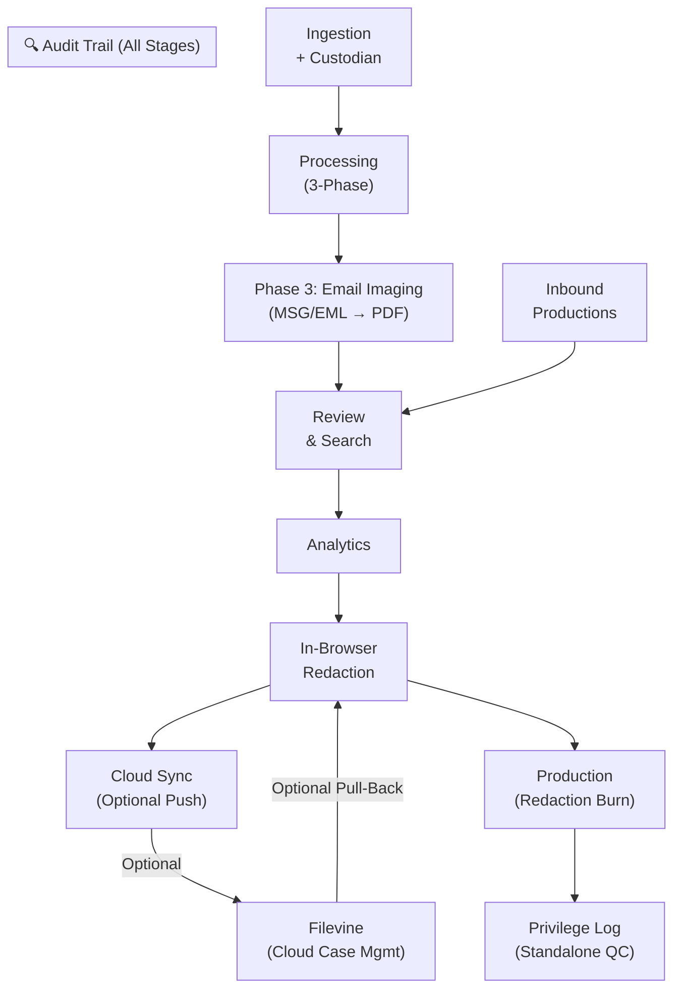
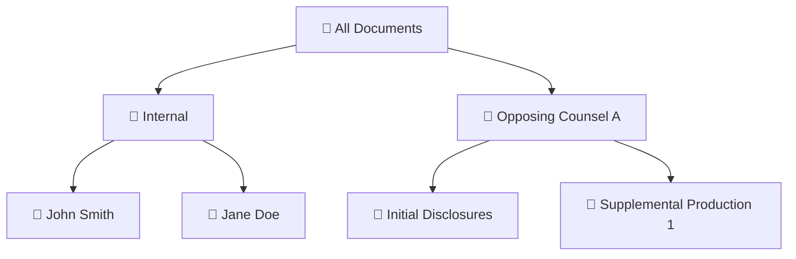

# Respondeo — E-Discovery Platform Overview

> **Document Classification:** Confidential
> **Platform Version:** Beta 2.15 (May 2026)
> **Prepared For:** Partners & Supervising Attorneys
> **Prepared By:** Respondeo maintainer
>
> **Recent Updates (Beta 2.15):** Family-expansion toggles in the Review module simplify navigation of email-attachment families (C3). Inbound-production documents now correctly appear in text-search results — a defect where volume-prefixed document IDs were silently dropped from the visible grid is fixed (C7, Flag #28).

## Executive Summary

**Respondeo is a turnkey, internally hosted litigation platform that eliminates the firm's reliance on expensive third-party e-discovery vendors** while delivering the same level of processing power, search precision, and production-grade output that Relativity and similar enterprise tools provide — at a fraction of the cost.

Built specifically for the demands of complex civil litigation, the platform handles every stage of the EDRM lifecycle — from raw data ingestion through Bates-stamped production and cloud case management sync — through a single, browser-accessible interface.

### Why This Matters to the Firm

- **Dramatic Cost Reduction.** By processing, reviewing, and producing documents entirely on firm-controlled infrastructure, the platform eliminates third-party vendor fees that routinely cost \$25 to \$75+ per gigabyte when combining ingestion processing, analytics-enabled hosting, and per-user platform licensing.
- **Hundreds of Review Hours Saved.** Intelligent features — including **automated email threading**, **near-duplicate detection**, and **junk image filtering** — allow reviewers to bulk-code families of redundant boilerplate documents in seconds, drastically reducing reviewer fatigue and recapturing billable hours that would otherwise be spent slogging through duplicative content.
- **Absolute Family Integrity.** The platform *mathematically guarantees* that no attachment will ever be severed from its parent email or container — the single most critical defensibility requirement in modern e-discovery. Whether you are coordinating discovery across **11 different parties in a large construction defect case**, or managing records for a **government entity suing a contractor**, every parent-child relationship in the dataset is preserved from ingestion through final production.
- **Seamless Cloud Integration.** Processed and produced documents automatically sync to the firm's **Filevine** case management platform via secure API, eliminating the manual upload-and-map workflow that currently consumes paralegal hours on every case.

### Modular Pipeline Architecture

The platform operates as a ten-stage pipeline. Each stage is independent, auditable, and recoverable — meaning a failure at any point never corrupts upstream work:

Every document progresses through this pipeline with its **family relationships preserved at every stage**. Opposing counsel productions enter the pipeline via Module 8 and flow directly into Review for search and analysis. Below, each module is explained in terms of its value to the litigation team.

## Case Lifecycle Management

The platform provides centralized tracking for the entire lifecycle of a litigation matter. Administrators can transition cases through active states (e.g., Active, Processing, Archived) which instantly gates downstream permissions and visually informs the entire team of the case's current status on the Home dashboard.

### Matter Profile

Every case opens with a **Matter Profile** — a ten-field summary card displayed prominently on the Home dashboard. Key fields include matter number, case caption, court, presiding judge, filing date, and trial date. This gives any attorney or paralegal who opens the case immediate context — no hunting through email or document management systems to recall basic case information.

### Case Archive

When a matter is concluded or needs to be transferred to long-term storage, administrators can create a **Case Archive** directly from the Home dashboard. A single click generates a ZIP package of the entire case folder accompanied by a `MANIFEST.json` that inventories every file in the archive. This ensures reliable long-term preservation and provides a verifiable record of exactly what was archived — critical for meeting data retention obligations and simplifying case transfers between firms.

### Closed-Case Read-Only Protections

When a case is marked as **Archived** or **Closed**, the platform automatically enforces **read-only mode across every module** — no additional configuration required. This is a critical defensibility feature that prevents accidental or unauthorized modification of a concluded matter's record.

- **Write-only pages** (Ingestion, Processing, Production, Filevine Sync) are **completely blocked** — users see a clear notification that the case is closed and cannot proceed.
- **Mixed-access pages** (Review, Analytics, Custodians, Exhibits) remain **fully readable** — attorneys can still search, view documents, run reports, and export data — but every individual write operation (tagging, redaction, coding changes, custodian edits) is independently blocked with an explanatory message.
- **Audit trail access is never restricted** — the complete history of all actions taken on the case remains searchable and exportable regardless of case status.

This design ensures that a closed case's evidentiary record is frozen in place while still allowing the litigation team to reference and cite its contents in ongoing proceedings, appeals, or audits.

## Automated Data Ingestion

### What It Delivers

When a new document dump arrives — whether from opposing counsel, a custodian's hard drive, or a forensic collection — the platform inventories every file and establishes a **digital chain of custody** by recording each file's cryptographic fingerprint (MD5 hash), file size, and original directory path. This creates the auditable master inventory against which all downstream processing operates.

### Key Capabilities

- **Parallel Processing.** Multi-threaded scanning processes large data volumes rapidly — configurable to leverage up to 8 CPU threads simultaneously.
- **Custodian Tracking.** Every document collection requires a custodian designation at ingestion (e.g., "John Smith" or "Jane Doe's Laptop"). This metadata drives the hierarchical folder navigation in the Review module, enabling attorneys to browse documents by custodian. A bulk backfill utility allows custodian assignment to previously ingested documents.
- **Idempotent Design.** If a load is interrupted or needs to be re-run (e.g., additional custodian data arrives mid-case), the system automatically skips files already registered, preventing duplicate entries without any manual intervention.
- **Self-Isolation.** The system's own output folders are automatically excluded from scanning, eliminating any risk of the platform accidentally ingesting its own processed work product.

## Intelligent Document Processing

### What It Delivers

This is the engine room of the platform. Every registered file is analyzed across three sequential phases: containers are exploded, text and metadata are extracted in parallel, and emails are automatically imaged to PDF for attorney review.

### Key Capabilities

#### Container Explosion with Full Lineage Tracking

Compound files are the highest-risk area in e-discovery processing. A single Outlook `.msg` file may contain dozens of attachments, some of which may themselves be forwarded emails with their own attachments — creating deeply nested family trees. The platform handles this with precision:

- **Outlook Emails (`.msg`)** are processed through a carefully engineered sequential pipeline using Microsoft Outlook's own MAPI engine, guaranteeing bit-perfect attachment extraction. Every attachment is linked back to its parent email in the case database.
- **Outlook PST Archives (`.pst`)** are automatically extracted during processing using a dual-path strategy: a headless pure-Python extraction engine (`libpff`) runs as the primary path, with automatic fallback to Microsoft Outlook COM automation when `libpff` is unavailable. The `libpff` engine runs in an isolated subprocess, requiring no desktop session or Outlook installation — ideal for unattended server deployments. Either path produces identical downstream results.
- **Nested Emails** (an email forwarded as an attachment inside another email) are automatically detected and routed for recursive processing, preserving multi-generational family chains.
- **Inline Signature Image Filtering.** Corporate email signatures frequently contain small embedded images (logos, social media icons) that are not meaningful attachments. The platform detects these inline-flagged images — even when they lack standard Content-ID headers — and automatically excludes them from the attachment inventory, preventing dozens of irrelevant micro-images from inflating the review set.
- **Filename Collision Prevention.** When multiple parent emails each contain identically named attachments (e.g., `image001.png`), the system ensures zero filename collisions through unique identifier prefixing — eliminating a common source of silent data loss in competing tools.
- **Intelligent File Type Detection.** When email attachments arrive with generic or incorrect file extensions (e.g., `.bin`), the platform inspects the file's internal structure to determine the true format (PDF, JPEG, Word, etc.) and assigns the correct extension — ensuring accurate processing downstream.

#### Deduplication with Family-Integrity Safeguards

Exact-duplicate detection uses cryptographic fingerprinting (MD5 hashing) to identify and suppress redundant copies of identical files, reducing review volume without losing evidentiary completeness.

> [!IMPORTANT]
> **Critical Malpractice Prevention Feature: Attachment Dedup Bypass**  
> The platform enforces a strict rule: **attachments are never suppressed by global deduplication.** If two different emails each contain the same PDF attachment, both copies are preserved in the review set. Without this safeguard — which is absent from many basic processing tools — the second email's family tree would be silently severed, destroying a legally significant parent-child relationship and creating a **spoliation risk** that could be raised by opposing counsel at any point during litigation.

#### De-NIST Filter Configuration

Before processing begins, the platform applies a **De-NIST filter** — an industry-standard exclusion of known system files (operating system components, software installers, font files, and similar non-evidentiary content) based on file extension. Administrators can customize the exclusion list on a per-case basis: adding extensions, removing them, saving the configuration, or resetting to the NIST standard defaults. An **Exclusion Report** is available showing exactly which files were filtered and why — providing a defensible, documented basis for every file removed from the processing pipeline.

#### Hash Integrity Verification

At any point after processing, administrators can run a **Hash Integrity Check** that re-computes the cryptographic fingerprint of every processed file and compares it against the original ingestion hash. Any file whose current hash does not match its original is immediately flagged. This detects accidental modification, file system corruption, or any unintended alteration — providing a mathematical guarantee that the documents in review are bit-for-bit identical to what was originally collected.

#### Automated Junk Image Filtering

HTML emails routinely contain dozens of micro-images: email signature icons, social media buttons, tracking pixels, and branding graphics. Reviewing these wastes attorney time and inflates document counts. The platform automatically identifies and tags these images (based on file size and pixel dimensions) as **"Junk"**, removing them from the default review set and production output — **without deleting them from the case**, preserving the complete defensible record.

#### Enterprise-Grade Full-Text Indexing

All extracted text is instantaneously indexed into a dedicated search engine, enabling the powerful Boolean search capabilities described in Module 4 below. The indexing pipeline is fault-tolerant: a single corrupted or unreadable document will never block the processing of thousands of others.

#### Pre-Review Email Imaging (Phase 3)

After text extraction completes, the platform automatically renders every internal email (`.msg` and `.eml`) to a standardized PDF using a native rendering engine that requires no external software. This step ensures that **every email has a viewable, redactable PDF available before it reaches the Review module** — eliminating the need for attorneys to request imaging on demand or wait for the production phase. Email headers display complete sender and recipient information including full SMTP email addresses — not just display names.

- **PDF alongside native.** The rendered PDF is stored in the `Processed` folder next to the native email file. Both are preserved and traceable through the database.
- **No impact on analytics.** Email imaging runs after metadata extraction and deduplication, so it has zero impact on threading, near-duplicate detection, or content hashing.
- **Idempotent.** If re-run, the system skips emails that already have a PDF, making the process safe to restart.
- **Hardened Rendering Pipeline.** The email imaging engine includes multiple safety layers: blank trailing pages are automatically stripped, external image URLs are neutralized to prevent data leakage, a 50-page safety cap prevents runaway rendering from malformed HTML, and the PDF conversion engine runs with JavaScript disabled and strict error handling — ensuring stable, predictable output regardless of how badly formed the source email is.

#### Background Processing & Session Independence

Processing runs as a **detached background process** on the server — completely independent of your browser session. You can close the browser tab, navigate away, or even log out: processing will continue uninterrupted. When you return to the Processor page, the **Job Monitor** picks up right where it left off, showing live progress with phase-colored banners, document counts, and an expandable warnings panel. A **Cancel** button allows graceful mid-run cancellation at any time. The platform prevents duplicate runs by detecting active jobs before allowing a new one to start, and automatically detects and cleans up orphaned jobs if the server is restarted.

#### Processing Exception Report

When processing completes, a **Processing Exception Report** provides immediate visibility into any files that could not be successfully processed. The report surfaces four key metrics (total failures, failure rate, breakdown by type, and affected custodians) and exports to a three-sheet Excel workbook with summary statistics, per-file failure details, and failure-type analysis. This gives case managers a clear, actionable picture of processing health without digging through logs.

## Review Analytics — Threading, Near-Duplicates & Communication Intelligence

### What It Delivers

Advanced litigation analytics operations designed to **eliminate redundant review work**, compress review timelines, and surface communication patterns:

### Email Threading

The threading engine reconstructs complete email conversation chains by analyzing industry-standard email header data (`Message-ID`, `In-Reply-To`, `References`).

- **Inclusive emails** — the final message in each conversation thread — are flagged as the only documents a reviewer *must* read, because they contain the full conversation context including all prior replies.
- **Thread-Suppressed emails** — earlier messages in the chain whose content is fully quoted in a later reply — are automatically suppressed from the active review set.

**Result:** In a dataset with extensive email correspondence, threading can reduce the active review population by **40–60%** while maintaining complete evidentiary coverage.

> [!IMPORTANT]
> **Defensibility Guarantee: Threading Never Suppresses Attachments**  
> The threading algorithm is explicitly constrained to evaluate only root-level emails. **Attachments are never candidates for thread suppression.** This prevents a scenario where a standalone PDF — which has no email threading headers — could be incorrectly classified as a redundant thread member and suppressed from the review set.

### Near-Duplicate Detection

The near-duplicate engine identifies documents that are **substantially similar** (default threshold: 90% content overlap) — such as minor letter revisions, slightly reformatted contracts, or boilerplate documents with trivial variations.

- Within each cluster of near-duplicates, the system elects the most metadata-rich document as the **Principal** (the document with the most complete email headers, dates, and author information). In the event of a tie, the system strictly priorities preserving the **earliest / lowest Control Number** as the Principal.
- The UI provides complete transparency before execution, breaking down the exact number of Total Duplicates, Preserved Attachments (that cannot be safely suppressed), and the Actual Reduction (standalone documents that are candidates for suppression).
- The matching engine compares documents using **five-word phrase windows** rather than isolated words, so documents that share vocabulary but say different things — two invoices on the same template, for instance — are no longer mistakenly grouped together. This materially reduces false-positive suppressions on template-style records.

> [!IMPORTANT]
> **Defensibility Upgrade: Reviewer-Gated Suppression (v2.16).** Near-duplicate suppression is no longer automatic. The algorithm *identifies* candidate clusters; a **reviewer confirms each one**, document by document, in a dedicated cluster-review surface with a side-by-side text-difference view. Only reviewer-confirmed, non-family documents are suppressed — and every suppression is attributed to a named reviewer with a timestamp. This "fail-open" design means nothing is ever withheld from production on the algorithm's say-so alone, and the **Defensibility Report** now carries a dedicated **Near-Duplicate Cluster Review & Attestation** section documenting exactly which clusters were reviewed, by whom, and how every document in them was dispositioned (suppressed, retained for family integrity, determined distinct, or still pending). This is the kind of human-in-the-loop, fully-attributable record that withstands a Rule 26(g) challenge.

**Result:** Near-duplicate detection enables reviewers to **bulk-code entire families of redundant boilerplate documents** — redline variants, form letters, signature pages — saving dozens of review hours per case, while keeping every suppression decision defensibly tied to a human reviewer.

> [!IMPORTANT]
> **Defensibility Guarantee: Child Documents Are Never Suppressed as Near-Duplicates** — a family-attached document is retained even when a reviewer confirms it is a duplicate, preserving the parent-child relationship.

### Custodian Overlap Analysis

The **Custodian Overlap Analysis** tab identifies which custodians share the most documents by comparing cryptographic content hashes across the entire case. Results are displayed as an interactive Plotly heatmap showing the overlap density between every custodian pair. This is directly useful for deposition preparation — when two custodians share a high volume of identical documents, attorneys know those individuals were exchanging or receiving the same materials, making them natural candidates for questioning about the same events.

### Concept Explorer

The **Concept Explorer** uses the search engine's statistical text analysis to surface terms and concepts that are semantically related to attorney-supplied seed keywords. When an attorney enters a search term like "termination," the platform identifies statistically significant co-occurring terms across the corpus — revealing related concepts the attorney may not have considered. This is particularly valuable during **search term negotiation** with opposing counsel: attorneys can demonstrate that their proposed terms capture the relevant conceptual space, or discover gaps in their term list before committing to a protocol.

### Communication Analysis, Timeline & Domain Intelligence

Three exploratory analytics views give attorneys and case managers **immediate visibility into who communicated with whom, when, and across which organizations** — without manually reading a single email:

- **Communication Analysis** — Identifies the top communicators in the dataset by email volume, generates a sender-by-recipient matrix showing communication density between individuals, and summarizes document volumes by custodian. This is invaluable for identifying key witnesses and understanding organizational communication patterns early in a case.
- **Timeline Analysis** — Visualizes email volume over time with configurable granularity (daily, weekly, monthly) and custodian filtering. The system automatically detects and highlights communication gaps — periods with unusually low or zero email activity — which may indicate missing collections, data preservation issues, or relevant time periods warranting deeper investigation.
- **Domain Analysis** — Maps communication patterns between email domains, classifying them as internal (firm/company domains) or external (opposing counsel, vendors, third parties). This helps attorneys quickly identify which outside organizations were most heavily involved in the relevant events.

## Interactive Document Review & Search

### What It Delivers

The Review Grid is the primary interface attorneys and paralegals will use daily. It presents every processed document in a sortable, filterable data grid with integrated visual preview, full metadata inspection, and tagging capabilities.

### Key Capabilities

#### Hierarchical Family Display

Documents are displayed in a **family-grouped hierarchy** that visually mirrors the original parent-child-grandchild relationships of the source data. Attachments appear directly beneath their parent email, indented with visual indicators (`↳`), regardless of how deeply nested they are.

> [!NOTE]
> **Why This Matters for Review.**  
> Many review platforms display family groups as flat blocks, causing deeply nested items (e.g., an attachment inside a ZIP inside a forwarded email) to appear disconnected from their direct parent. Our **lineage-aware sorting algorithm** guarantees that every child snaps directly beneath its parent in the grid at arbitrary depth — creating a clear visual chain of custody that reviewers can follow intuitively.

#### Built-In Document Preview

The Review Grid includes a tabbed preview panel that eliminates the need to download and open files locally. Supported formats include:

- **PDFs** — rendered inline in the browser
- **Images** — displayed natively
- **Excel, Word, PowerPoint** — rendered as on-demand PDFs
- **Outlook Emails (.msg / .eml)** — displayed with full header metadata and body content
- **Spreadsheets** — interactive preview of the first 500 rows

#### Folder Tree Navigator

The Review sidebar features a **hierarchical document navigator** that organizes the entire document corpus by origin:

- **Internal documents** are grouped by **Custodian** (the person whose collection the documents came from)
- **Opposing counsel productions** are grouped by **Production Volume** (e.g., "Initial Disclosures", "Supplemental Production 1")
- Clicking any level in the tree **instantly scopes** both the SQL query and OpenSearch search to that subset
- An **"All Documents"** root level enables cross-party search across the entire case database
- Document counts are displayed at every level for instant volume awareness

#### Date Range Filtering

The Review Grid supports **From/To date filtering** on both `Date Sent` and `Date Received` fields. Attorneys can instantly scope the review population to a specific time window — for example, filtering to the six-month period surrounding the events at issue. This is one of the most effective ways to reduce review volume on cases with large custodian collections spanning many years.

#### Smart Filtering

| Filter | Default | Benefit |
|---|---|---|
| **Show Suppressed** | Off | Hides exact duplicates and thread/near-dupe suppressed documents, dramatically reducing review volume |
| **Hide Junk Images** | On | Removes signature icons, tracking pixels, and other micro-images that add no evidentiary value |

#### Intelligent Tag Categories & Bulk Coding

Documents are reviewed and visually categorized using a protected tagging framework. The system actively groups metadata to keep the workflow clean:

- **System Tags:** Read-only badges (e.g., `NearDupe-Suppressed`, `Junk Image`) generated during processing. These are visually isolated from user tags and cannot be accidentally bulk-deleted by reviewers.
- **User Categories:** Customizable tagging categories (e.g., *Privilege*, *Issues*, *Responsiveness*).

When an attorney selects multiple rows in the Review Grid (such as an entire cluster of near-duplicated boilerplate contracts), a **⚡ Bulk Action Bar** automatically slides into view. This permits reviewers to mass-apply or mass-clear user tags across dozens of documents simultaneously, yielding massive efficiency gains.

#### Issue Coding

Beyond standard tags, the platform supports **custom Issue Coding fields** that attorneys define on a per-case basis. Administrators configure coding fields in Case Maintenance, choosing from picklist, free-text, and boolean field types. During review, attorneys apply these structured codes to documents — capturing case-specific categorizations such as "Contract Formation," "Breach Notice," or "Damages Calculation." Issue coding values are **attorney work product** and are intentionally excluded from DAT/CSV production load files delivered to opposing counsel, ensuring that the firm's analytical work product is never inadvertently disclosed.

#### Reviewer Notes

Each document supports **per-user reviewer notes** — free-text annotations that reviewers can leave for themselves or colleagues during review. Notes are tied to the individual reviewer's identity and appear alongside the document in the Review panel. Unlike tags (which are visible to the entire team and drive production decisions), notes provide a private workspace for capturing observations, questions, or follow-up items during the review process.

#### Confidentiality Designation Override

While production runs apply a default confidentiality designation across the entire production set, attorneys can override this at the **individual document level** during review. A specific document can be marked as "Confidential," "Highly Confidential — Attorneys' Eyes Only," or any other designation defined in the case's protective order — regardless of the production-wide default. This ensures that sensitive documents receive appropriate protection without requiring a separate production run.

#### Selective Re-Image

When an email's PDF rendering has issues — blank pages caused by external image references, oversized output from complex HTML formatting, or other rendering artifacts — managers can trigger a **Selective Re-Image** directly from the Review module. This re-renders the email to PDF using the current (hardened) imaging pipeline. Because the document's visual content may change, the platform automatically resets the document's review state (reviewer assignment, privilege coding, and confidentiality designation), ensuring that no stale review decisions carry forward on the updated rendering. A two-click safety mechanism (button followed by confirmation) prevents accidental re-imaging.

**Tag Cascade to Attachments.** When a tag is applied to or removed from a parent email, the same change automatically cascades to all of its attachments. This ensures that privilege or responsiveness coding decisions on a parent document are consistently reflected across its entire family — eliminating the risk of an attachment slipping through with an inconsistent tag. System-generated tags (such as Near-Duplicate or Thread-Suppressed flags) are never overwritten by cascade operations.

**Family Peek Navigation.** When a reviewer clicks a parent or child link in the Family panel but the target document is filtered out of the current search, the platform enters "Peek mode" — loading the target directly in the viewer without disrupting the grid or search context. A single click returns the reviewer to their original queue position. This eliminates the tedious workflow of clearing a search to find a family member, then re-entering the search to resume review.

**Show Full Family.** A dedicated button replaces the Review Grid with every member of the current document's family — parent email plus all attachments — regardless of active search or filter settings. A banner provides one-click restoration of the prior search state.

**Produced Document Download.** For documents that have already been through production, a download button provides the final Bates-stamped PDF directly from the Review interface — allowing attorneys to quickly verify what was actually delivered to opposing counsel without navigating to the production output folder.

#### Bates Batch Search & Micro-Extraction

When responding to or analyzing written discovery, reviewers are consistently tasked with investigating massive, chaotic lists of Bates numbers (e.g., `ABC-001005, ABC 1009; XYZ 003-005`). 

The platform's **📋 Bulk Bates** engine allows users to simply copy-paste these dirty citations into a popover. The system's mathematical intersection logic will instantly filter the review grid to the exact documents containing those pages. From there, reviewers can trigger the **📑 Extract Exact Pages & ZIP** command, which leverages PyMuPDF to crack open the multi-page source PDFs, slice out *only* the specific pages the opposing counsel cited, and package them as single-page PDFs into an immediate, downloadable ZIP file.

### What It Delivers

Instantaneous, Boolean-supported text retrieval across the **entire document corpus** — ensuring no critical keyword hit is ever missed, regardless of dataset size.

### Key Capabilities

- Full **Boolean syntax** support: `AND`, `OR`, `NOT`, wildcards (`*`), exact phrase matching (`"quoted terms"`), and field-specific queries.
- **Keyword highlighting** in search results, with yellow-highlighted snippet previews showing exactly where and how each term appears in the document.
- **Persistent Search Term Report (STR) Highlighting.** When a paralegal runs a Search Term Report from the Review module's 📊 Search Term Reports view, those terms are automatically carried over into the Review viewer. Every matching word in the document text is highlighted in yellow — giving attorneys immediate visual confirmation that the document is responsive to the opposing party's search terms, without re-running any searches.
- **Family-aware results display.** Attachments are visually distinguished with a `📎 [Attachment]` prefix and their parent control number displayed inline. A **"View Family"** button on each result instantly displays the complete family group for any document.
## In-Browser Document Redaction

> **Where to find it:** The ✏️ **Redact** tab is the fourth tab inside **Module 4 — Review**, directly alongside the Native/Image, Extracted Text, and Production (Bates) viewer tabs. Attorneys stay in the Review module without losing their grid position. There is no separate Redaction page.

### What It Delivers

Attorneys and paralegals can draw, review, and finalize redaction boxes directly in the browser — on any document in the case — without external tools, third-party software, or a Filevine round-trip. Every redaction box carries its own individual privilege reason, and redactions remain fully reversible until production is run.

### Key Capabilities

- **Integrated with Review.** The ✏️ Redact tab lives inside Module 4 — Review. Attorneys click the Redact tab on any document in their review queue without navigating to a separate page or losing their position in the grid.
- **One-Click Canvas Load.** The first time an attorney opens the Redact tab for a document, they click **🖊️ Load Redaction Canvas** to initialize the annotation tools. This click persists for the entire session on that document — they do not need to re-click when navigating between pages.
- **Direct In-Browser Drawing.** Using a canvas overlay on the document's rendered PDF, users draw rectangular redaction boxes over text, images, or any content requiring withholding. No plugins, no downloads, no external PDF editor required.
- **Side-by-Side Layout.** The canvas takes the right 70% of the panel. The left 30% shows page navigation controls, the Draw/Select tool toggle, per-box privilege reason selectors, and the Save/Clear action buttons — so everything is visible without scrolling past a tall canvas.
- **Per-Box Privilege Reasons.** Each redaction box is individually labeled with its privilege basis (e.g., Attorney-Client Privilege, Work Product, Trade Secret). A single document page with three boxes can carry three different privilege reasons — one per box — matching the actual legal basis for each withholding.
- **Non-Destructive Until Production.** Redaction marks are visible black boxes in the document preview, but the underlying content is preserved in the platform until production is run. Attorneys can review the redacted pages in the browser to confirm placement before committing. Marks can be moved, resized, or cleared at any point before production.
- **Automatic Privilege Tag Sync.** When redaction marks are saved, the document's privilege tags are automatically updated to match the current set of mark reasons. If all marks are cleared, the privilege tags are cleared too. This prevents any mismatch between what is redacted and what is logged on the privilege log.
- **Multi-Page Navigation.** Redaction marks are managed page by page. Users navigate with ◀ / ▶ arrow buttons or by typing a page number directly into the navigation box. Marks from each page are stored independently and visible on subsequent visits to the document.
- **No Filevine Round-Trip Required.** The platform has a complete native redaction workflow. The Filevine sync option (described below) is still available for firms that prefer it, but it is no longer the primary or recommended path.

> [!IMPORTANT]
> **Defensibility Guarantee: Redactions Are Never Burned Prematurely**
> The platform enforces a strict separation between marking and burning. Drawing a redaction box in the browser creates a visible black annotation on the PDF, but the underlying text is preserved in the file until Production is explicitly run. `apply_redactions()` — the operation that permanently removes content from the PDF binary — is called **only** during the Production run. This means attorneys can review and confirm every redaction placement before locking in the production set. Once a document has gone through production with redactions, the produced copy has content permanently removed; the original in the `Processed/` folder is always preserved.

> [!IMPORTANT]
> **Defensibility Guarantee: Per-Box Privilege Reasons Are Audit-Logged**
> Every time redaction marks are saved or cleared, the action is recorded in the platform's audit trail with the username, timestamp, document control number, and the reasons assigned to each box. This creates a complete, court-defensible record of who made every redaction decision on every document.

## Document Split & Trim

> **Where to find it:** The ✂️ **Split** tab appears alongside the other viewer tabs in **Module 4 — Review**, visible to users with the `split_document` permission (Manager+).

In real-world discovery, batch-scanned PDFs and multi-section documents frequently need to be broken apart into their logical components, or non-responsive pages need to be removed before production. The platform handles both scenarios natively:

- **Split into Ranges.** A multi-page PDF can be divided into multiple independent documents by defining page ranges (e.g., pages 1-50 and 51-100). Overlap and gap detection validates the ranges before execution. Each split child receives its own control number and is automatically queued for text extraction and indexing.
- **Trim Pages.** Specific pages can be removed from a document (e.g., remove blank pages, cover sheets, or non-responsive sections). The result is a single trimmed child document with correct page numbering.
- **Legal Metadata Inheritance.** Split and trim children inherit all legal metadata from their parent — including privilege status, confidentiality designation, clawback status, tags, custodian, dates, and email metadata. This ensures no privilege or confidentiality designations are lost when restructuring documents.
- **Defensibility Lineage.** The `split_source_cn` column on each child points back to the original parent, and the parent is marked as `Split_Source` (hidden from the review grid but preserved in the database for audit purposes). The full chain of custody is audit-logged.

## Court-Ready Production & Export

### What It Delivers

Takes the reviewed, tagged document set and generates a **court-ready production package** with sequential Bates numbering, industry-standard load files, and automatic **Privilege Log generation** — ready for delivery to opposing counsel or filing with the court.

### Key Capabilities

#### Customizable, Family-Aware Bates Stamping

Bates numbers are assigned using a family-aware sorting algorithm that guarantees **contiguous numbering within family groups** — a parent email and all of its attachments will always have adjacent, sequential Bates numbers. This is critical for defensibility: opposing counsel and the court can immediately identify related documents by their Bates range.

The platform provides complete customization over the production format:
- Configurable Bates prefix, starting numbers, and dynamic **padding length** (e.g., 6 digits vs 8 digits).
- Selectable Bates stamp location (e.g., bottom-right) and variable font sizes.
- Color formatting (red or black font) for improved visibility on challenging images.

Junk images are automatically excluded from the production set before Bates stamping begins, and the numbering sequence is recalculated to ensure no gaps.

#### Universal Document Imaging

The production engine converts all source documents into standardized, court-ready PDFs:

| Source Type | How It's Handled |
|---|---|
| **Outlook Emails (.msg)** | Rendered to PDF with full headers (From, To, Date, Subject, Attachments listed) and inline images preserved |
| **Word, Excel, PowerPoint** | Converted via Microsoft Office engine in isolated processes with automatic timeout protection |
| **Images** | Wrapped directly into PDF format |
| **Text Files** | Rendered onto standard A4 PDF pages |
| **Existing PDFs** | Passed through directly |

> [!NOTE]
> **Email Rendering Integrity.**  
> Outlook emails are rendered to PDF using a sophisticated pipeline that preserves inline images (e.g., embedded charts or screenshots in the email body) while correctly listing physical attachments (PDFs, Word documents) in the email's `Attachments:` header line. This ensures the produced PDF is a faithful, visually accurate representation of the original email as the sender intended it.

#### TIFF Production Support

For matters requiring TIFF-format productions, multi-page PDFs are automatically exploded into single-page TIFF files at 300 DPI — the industry-standard resolution for litigation imaging.

#### Native Only Production

For matters where native file production is agreed upon by the parties, the platform produces original files renamed to Bates numbers with slip-sheet PDF placeholders — meeting production requirements without converting to image format. This is particularly useful for spreadsheets, databases, and other formats where the native file is more useful to the receiving party than a static image.

#### Supplemental Production Continuity

When running a follow-up production volume (e.g., "Volume II"), a single toggle automatically resumes Bates numbering from exactly where the previous production ended — guaranteeing cross-volume continuity with no gaps or overlaps. The platform remembers the last production's prefix, ending Bates number, and padding format.

#### Multi-Production Tracking

Documents can appear in **multiple production volumes** — original, supplemental, and replacement productions are all tracked independently. The platform maintains a complete production history for every document, recording which volume it was included in, when, and with what Bates range. In the Review module, documents that have been produced in multiple volumes display their full **Production History**, and the system surfaces **stale-production warnings** when a document has been re-processed or re-imaged after its most recent production — alerting the team that the produced version may not reflect the current state of the document.

#### Clawback Protection

Documents that have been marked with a clawback demand (see the Clawback workflow in the Review module) are automatically excluded from all future production sets by default, preventing inadvertent re-production of privileged material.

#### Cancellation Safety

Long-running production jobs can be safely cancelled mid-run via an on-screen cancel button. On cancellation, any partially completed volume is automatically cleaned up to prevent orphaned Bates number assignments or incomplete production packages.

#### Stale-File Detection

On page load, the Production module automatically scans for orphaned `TEMP_` and `STAGED_` files left behind by abandoned Pass 1 imaging runs (e.g., from a browser crash or server restart mid-production). If any are found, a warning banner identifies the affected volumes and offers a **Clean Up Orphaned Files** button (Manager+). Cleanup is logged to the audit trail as `PRODUCTION_STALE_CLEANUP`.

#### Industry-Standard Load Files

Every production package includes the following deliverables:

| File | Format | Purpose |
|---|---|---|
| **LOADFILE.csv** | Standard CSV | General-purpose document index for any review platform |
| **LOADFILE.DAT** | Concordance DAT | Direct import into Relativity, Concordance, and similar platforms |
| **IMAGES.OPT** | Opticon OPT | Image-level load file for TIFF productions |

#### Automated Privilege Log Generation

Constructing privilege logs is typically one of the most tedious and expensive paralegal tasks in e-discovery. The platform handles this in two ways:

- **Production-Embedded Privilege Log.** During every production run, a Privilege Log `.csv` is automatically generated into the production package, listing all withheld documents with Bates ranges, header metadata, and privilege rationale.
- **Privilege Log QC Editor.** A dedicated pre-production QC tool accessible at any time — no production run required. The editor provides a filterable data grid with disposition, custodian, privilege basis, and date range filters, plus a "Show only Needs Disposition" convenience toggle to surface documents requiring attorney attention. A six-metric summary bar shows withheld, redacted, needs-disposition, with-Bates, and without-Bates counts at a glance. A per-case column picker (19 available columns, EDRM defaults) controls which fields appear in the exported CSV/Excel — column configuration persists across sessions. The platform's built-in abbreviation normalizer automatically converts reviewer shorthand (e.g., "AC", "WP", "ACP") into the full canonical privilege descriptions ("Attorney-Client Privilege", "Attorney Work Product") for clean, court-ready output.
## Exhibit List & Trial Binder

### What It Delivers

Once documents have been produced, the next step in the litigation lifecycle is designating exhibits for depositions, motions, hearings, and trial. The **Exhibit List** module bridges the gap between production output and courtroom preparation — allowing attorneys to organize produced documents into named exhibit sets and export assembled binder PDFs ready for filing or distribution.

### Key Capabilities

- **Named Exhibit Sets.** Attorneys create purpose-specific exhibit collections — "Deposition of John Smith," "Motion for Summary Judgment," "Trial Exhibits" — each with its own exhibit numbering sequence. Multiple sets can exist simultaneously for the same case.
- **Freeform Exhibit Numbering.** Because courts and judges follow different numbering conventions, exhibit numbers are free-text fields. Whether the court requires "Exhibit A," "Plaintiff's Exhibit 1," or "Exhibit 101," the platform accommodates any convention.
- **Mark Exhibits During Review.** Reviewers can designate documents as exhibits directly from the Review module without switching to a separate page — keeping the exhibit identification workflow integrated with the document review process.
- **Dedicated Management Interface.** Managers organize exhibit sets on a dedicated management page where they can reorder exhibits, edit descriptions, and add or remove documents from a set.
- **Assembled Binder PDF Export.** Each exhibit set exports as a single, assembled PDF binder containing:
  - **Cover sheet** with case caption, exhibit set name, and proceeding date
  - **Index page** listing every exhibit with its number, description, Bates range, and binder page number
  - **Divider pages** between exhibits for easy physical navigation
  - **The actual produced documents** in exhibit order
- **Printer-Friendly Output.** All binder output is black and white, portrait orientation, and optimized for standard office printing — ready to be printed, bound, and handed to a witness or filed with the court.

---

## Filevine Cloud Case Management Sync

### What It Delivers

Automatically pushes processed documents and their complete metadata directly into the firm's **Filevine** case management platform, keeping the e-discovery record synchronized with the firm's central case file. For firms that prefer to conduct certain attorney reviews or annotations within Filevine, the platform also supports a pull-back workflow that retrieves annotated documents and routes them to production.

### Key Capabilities

- **One-Click Document Push.** Processed documents are securely uploaded to the designated Filevine project and collection through a four-step automated pipeline: pre-signed URL generation, encrypted file transfer, document finalization, and metadata mapping — all without user intervention.
- **Optional Pull-Back for External Annotation.** For firms that use Filevine's built-in PDF annotation tools, the platform's **Pull Reviewed Documents** function automatically queries Filevine, downloads annotated PDFs into an isolated `Reviewed` folder, and routes them to the production pipeline. This is an alternative workflow — native in-browser redaction (described above) does not require any Filevine interaction.
- **Non-Destructive Originals.** Whether redaction marks originate in the platform's native redaction module or from a Filevine pull-back, the original pristine PDF in the `Processed` folder is never modified. The production pipeline uses the most recent marked version, and content destruction occurs only at production time.
- **Enterprise-Grade Resilience.** The sync engine automatically handles transient API failures (rate limiting, server errors, network interruptions) with intelligent retry logic and exponential backoff — ensuring that temporary cloud service issues never result in data loss.
- **Token Expiration Handling.** If API authentication expires mid-batch, affected documents are flagged for re-sync rather than lost. The operator can re-authenticate and resume exactly where the process left off.
- **Data Integrity.** All metadata values are sanitized before transmission.

## Inbound Production Management

### What It Delivers

When opposing counsel produces documents, they typically arrive as a structured package containing a load file (`.dat` or `.csv`), image folders (PDFs or TIFFs), native files, and extracted text. This module safely ingests these third-party productions into the platform's unified review environment without contaminating the internal document processing pipeline.

**In beta-2.10, this capability became its own sidebar module** (📨 Inbound Productions, positioned between Production and Sync). Before the split, inbound ingest was a tab within the Production module; the separation was driven by a workflow-hazard analysis — the outbound production's phase-gating state machine was locking inbound ingest out whenever outbound was mid-Pass-1, even though the two workflows share no state or data dependencies. The module's capabilities below are unchanged from prior sprints, but the ingest surface is now always reachable regardless of outbound production state.

### Key Capabilities

- **Universal Load File Parsing.** Configurable delimiters and quote characters accommodate any vendor format — including the Concordance-standard `\x14` delimiter and `\xfe` quote character.
- **Flexible Column Mapping.** A visual mapping interface lets operators match load file columns to system fields (control number, custodian, email metadata, file paths). Unmapped columns are automatically preserved as searchable JSON metadata.
- **Automatic Image Discovery.** The platform recursively scans the production folder for PDFs and TIFFs, matching them to control numbers by filename. This eliminates the need for an explicit image path column in the load file — a common gap in opposing counsel productions.
- **Bates Gap Detection.** An automated capability identifies missing contiguous Bates numbers in external opposing counsel productions. If a production skips from `ABC-001` to `ABC-005`, the system immediately flags the missing range so an attorney can demand the missing documents.
- **Inbound Bates Cross-Reference.** Attorneys can quickly search the Review grid to map an opposing counsel's produced Bates number back to the platform's internal control number (and vice versa), ensuring seamless tracking during depositions and hearings.
- **Date Normalization.** Incoming dates in any format (`MM/DD/YYYY`, `YYYY-MM-DD`, natural language) are automatically converted to ISO format for consistent search and filtering.
- **Production Purge Utility.** If an ingestion needs to be corrected, a purge tool cleanly removes all traces of a specific production from the database, Elasticsearch index, and file system — with a safety confirmation step to prevent accidental deletion.
- **Complete Isolation.** Inbound productions are tagged with `source_party` and `production_volume` metadata, ensuring they never interfere with internal analytics (threading, deduplication) while remaining fully searchable and reviewable alongside internal documents.

## Complete Audit Trail & Defensibility Logging

### What It Delivers

Every user action on every document — across all twelve modules of the platform — is recorded with a complete, timestamped log entry tied to the user's identity. When opposing counsel challenges your discovery process, you have a complete, court-ready record of every decision made on every document, from the moment it was ingested through production.

### Key Capabilities

- **Universal Coverage.** The audit trail spans the entire EDRM lifecycle: document ingestion, text extraction, deduplication, tagging, commenting, redaction (every mark drawn, saved, or cleared), production Bates assignment, redaction burning, privilege log export, and user administration. No action falls outside the audit record.
- **Immutable, Append-Only Log.** Audit entries are never modified or deleted by any user action — including administrators. The log is a reliable, tamper-resistant record of the platform's complete activity history.
- **Who, What, Which Document, When.** Every entry records the username, action type, affected document (control number), the module where the action occurred, and both the before and after state for changes (e.g., when a tag changes, the old tag value and new tag value are both recorded).
- **Searchable and Filterable.** Administrators access the audit log through a dedicated viewer on the Home page. The log can be filtered by user, document, module, action type, and date range — making it practical to answer specific questions quickly.
- **Exportable for Court Submission.** The full audit trail (or any filtered subset) exports in three formats: CSV (for analysis), Excel (with frozen headers, auto-sized columns, and a metadata sheet documenting the applied filters), and PDF (landscape layout with repeating headers, page numbers, and "Privileged & Confidential" stamp). All suitable for submission to the court or opposing counsel.

### Typical Questions the Audit Trail Answers

| Question | How to Answer |
|----------|---------------|
| "Who reviewed document ABC004817 and when?" | Filter by Control Number = ABC004817 |
| "What did paralegal Jane Doe do on Tuesday the 4th?" | Filter by Username = jdoe + Date Range |
| "Show me all redaction activity on this case" | Filter by Module = Redaction |
| "When were Bates numbers assigned for Volume 2?" | Filter by Action = BATES_ASSIGNED |
| "Has anyone altered tags on produced documents?" | Filter by Action = TAG_APPLIED or TAG_REMOVED + Date after production run |
| "Export a complete audit trail for the court" | Clear all filters, click Export CSV |

> [!IMPORTANT]
> **Discovery-About-Discovery Defense.**
> In complex litigation, opposing counsel increasingly challenge the producing party's e-discovery process itself — questioning whether documents were reviewed consistently, whether privilege assertions were applied uniformly, and whether any documents were improperly withheld or improperly produced. The platform's audit trail directly addresses these challenges. Every privilege tag applied, every redaction mark drawn, and every production run is documented with the reviewer's identity and exact timestamp. The complete audit history is exportable in under a minute.

## Custodian Management & Legal Hold Tracking

### What It Delivers

A centralized registry for every data custodian in the case — with profile metadata, operational tools for correcting ingestion mistakes, and full legal hold lifecycle management. When a litigation partner asks "where do I track when holds were issued?", the answer is built into the platform.

### Key Capabilities

- **Custodian Inventory.** An interactive chart shows every custodian and their document count at a glance, color-coded by hold status.
- **Profile Management.** Store custodian title, department, email, notes, and data sources (Exchange Mailbox, Network Share, Laptop, etc.) for each custodian.
- **Rename, Merge & Reassign.** When a custodian was misspelled at ingestion, or two custodians need to be combined, or a subset of documents was assigned to the wrong person — the platform provides audited, one-click operations that cascade across all documents, the custodian registry, and hold records.
- **Legal Hold Lifecycle.** Track hold issuance, acknowledgment, and release dates per custodian. Record the notice method (email, letter, in-person) and recipient. Upload hold notices, signed acknowledgments, and release letters as attached administrative records.
- **Hold Document Storage.** Uploaded hold documents are stored completely outside the case document population. They never enter the processing pipeline, never get Bates numbers, and cannot be accidentally produced. They are attorney work product — administrative records about the discovery process itself.
- **Case Hold Summary.** A visual timeline (Gantt chart) shows the hold posture across all custodians — who is currently under hold, who has acknowledged, and who hasn't responded. This summary is what gets attached to a declaration opposing a spoliation motion.
- **Collection Scope Tracking.** A dedicated **Collection Scope** tab provides per-custodian, per-data-source status tracking. For every custodian, the team records the disposition of each potential data source — Collected, Searched-No-Hit, Not-Reasonably-Accessible, or Out-of-Scope — along with a written justification. This information feeds directly into the Defensibility Report (Section 2.2: Collection Scope & Justification). When opposing counsel challenges the scope of your collection, you have a documented, per-source record showing that every data source for every custodian was considered and a reasoned decision was made.

---

## Review Batch Management

### What It Delivers

When a managing partner asks "how do my three associates review this case?", the answer is: click "Create Batches," pick 3 reviewers, and each one sees their assigned queue when they log in. The batching system distributes the review workload evenly while keeping email families together.

### Key Capabilities

- **Intelligent Splitting.** The platform groups parent emails with their attachments and distributes family groups across batches, balancing by either document count or page count. No family is ever split across reviewers.
- **Soft Assignment.** A batch is "your queue to work through," not "the only documents you can see." Any reviewer can switch to "All Documents" at any time to pick up a colleague's work.
- **Explicit Review Tracking.** A document is marked "reviewed" only when a reviewer clicks **Reviewed — Next ▶** — not when they browse, search, or open it. This deliberate act is the reviewer's determination. Saving work-in-progress (tags applied but not yet finalized) uses the standard **Save** button and does not count toward review progress.
- **Real-Time Progress.** Each batch shows a completion percentage. A progress banner above the document grid shows "📦 Batch 1: 45 / 230 reviewed (20%)" in real time. Batch status auto-updates to "Complete" when all documents are reviewed.

---

## Defensibility Report Generator

### What It Delivers

A one-click, court-ready PDF that documents the entire e-discovery process — from collection methodology through production certification. This is what a litigation team attaches to a Rule 26(g) certification, a discovery response verification, or a meet-and-confer letter.

### Key Capabilities

- **Fully Automated.** Every data point in the report already exists in the platform's database. No manual data entry is required. One click assembles the report from live case data.
- **Nine Professional Sections.** Executive summary with key metrics, collection and ingestion methodology, processing protocol, four-layer deduplication rationale, review statistics with completion tracking, production certification with Bates ranges, privilege handling summary, audit trail overview, and legal hold status.
- **Outbound-Only Production Run History.** Section 6.2 of the defensibility report shows only outbound productions (productions the firm performed). Inbound ingests from opposing counsel are tracked separately under the Inbound Productions module and in the audit trail — they do not appear in the court-facing production history. Misrepresenting inbound ingestion as firm production would create a Rule 26(g) certification risk. Aborted production runs (started but not finalized) are excluded from section 6.2 entirely — internal process churn is not material to opposing counsel.
- **Home Page Production History Grid.** The home dashboard's Production History panel (paralegal-visible forensic record) shows ALL outbound runs including aborted ones, with a Status column and `—` placeholders rendered for missing Bates ranges. Asymmetric design: forensic visibility for case managers, court-clean output for opposing counsel.
- **Court-Ready Formatting.** Professional serif fonts, navy headers, alternating row colors, page numbers, and a "Privileged & Confidential — Attorney Work Product" cover page stamp.
- **Audit Trail Export.** The audit log can also be exported as a formatted PDF (landscape layout, repeating headers, filter criteria documented) for attachment to court filings.

---

## Enterprise-Grade Safeguards & Risk Mitigation

The following table summarizes the **proactive, advanced engineering safeguards** built into the platform to handle the notoriously messy, unpredictable, and inconsistent nature of raw litigation data. These are not afterthoughts — they are deliberate architectural decisions designed to prevent the most common (and most dangerous) failure modes in e-discovery processing.

| Risk Area | Safeguard | Why It Matters |
|---|---|---|
| **Family Integrity — Deduplication** | Attachments automatically bypass global deduplication | Prevents silent severance of parent-child relationships that could constitute spoliation |
| **Family Integrity — Threading** | Only root-level emails participate in thread analysis; attachments are excluded | Prevents standalone documents from being incorrectly suppressed as redundant thread members |
| **Family Integrity — Near-Duplicates** | Child documents are never suppressed, even with identical content | Preserves multi-party evidentiary context where the same document appears in different email families |
| **Outlook Email Stability** | Sequential, isolated processing of Outlook email files with aggressive resource cleanup | Eliminates an entire class of file corruption and data loss bugs caused by concurrent access to Outlook's internal data format |
| **Filename Collision Prevention** | Unique identifiers prepended to all extracted attachment filenames | Prevents silent overwriting when multiple parent emails contain identically named attachments |
| **Deeply Nested Family Display** | Lineage-aware hierarchical sorting in the Review Grid | Ensures grandchildren and deeply nested attachments appear directly beneath their parent — not pooled at the bottom of a family block |
| **Email Rendering Accuracy** | Inline images embedded into rendered PDFs; physical attachments routed to the header listing | Prevents the common defect where a Word document with a Content-ID is incorrectly embedded as an image, or inline charts are stripped from the rendered email |
| **Reviewer Fatigue Reduction** | Automated junk image detection, tagging, filtering, and production exclusion | Removes hundreds of meaningless micro-images (signature icons, tracking pixels) from the review and production pipeline |
| **Cloud Sync Resilience** | Automatic retry with exponential backoff for all API failures; token expiration detection and flagging | Guarantees no documents are silently lost during cloud synchronization, even under adverse network conditions |
| **Production Numbering Integrity** | Bates sequence recalculation after junk image exclusion | Ensures contiguous, gap-free Bates numbering in the final production package |
| **Search Engine Fault Tolerance** | Failed document indexing never blocks the processing pipeline | A single corrupted or unreadable file cannot prevent thousands of other documents from being processed and indexed |
| **Office Document Conversion Stability** | Each Office-to-PDF conversion runs in an isolated process with a 90-second timeout | A hung or frozen Microsoft Office instance cannot freeze the entire production pipeline |
| **Custodian Chain of Custody** | Custodian designation required at ingestion, propagated to all child documents | Every document in the review set and final production is traceable to its source custodian |
| **Inbound Production Isolation** | Opposing counsel documents tagged and stored separately from internal data | Third-party metadata anomalies cannot corrupt internal analytics or threader results |
| **Pre-Review Email Imaging** | All emails imaged to PDF during processing, before they reach the review queue | Attorneys never encounter an unviewable email in the review module; redactable PDFs are guaranteed |
| **Complete Audit Trail** | Every user action across all 12 modules is recorded with username, timestamp, document, and before/after state — exportable to CSV | Provides a court-ready defensibility record for discovery-about-discovery challenges; documents who tagged, redacted, and produced every document |
| **OCR Fallback for Scanned Documents** | When Tika extracts no text (image-only or scanned PDFs), the platform automatically runs Tesseract OCR via PyMuPDF page rendering | Scanned documents are indexed and fully searchable without any manual intervention — no document is left unsearchable because it was a scan |
| **Non-Destructive Redaction Architecture** | Redaction marks are visible black boxes in PDF annotations; `apply_redactions()` that permanently removes content is called only at production time | Attorneys can review, adjust, and confirm all redaction placements before content is irrevocably destroyed in the produced copy |
| **Tag Cascade Consistency** | When a tag is applied to a parent document, it automatically cascades to all attachments; system-generated tags are never overwritten | Eliminates the risk of an attachment shipping in a production set with an inconsistent privilege or responsiveness tag |
| **Clawback Hard Block** | Documents marked with a clawback demand are automatically excluded from all future production sets | Prevents re-production of inadvertently disclosed privileged material — a common and costly e-discovery error |
| **Inline Signature Image Filtering** | Corporate email signature images (logos, social media icons) are automatically detected and excluded from the attachment inventory, even without standard Content-ID headers | Prevents dozens of irrelevant micro-images per email from inflating the review set and consuming Bates numbers |
| **Cancellation Safety** | Long-running processing and production jobs can be cancelled mid-run; partial work is automatically cleaned up | Prevents orphaned Bates assignments, incomplete index entries, or half-processed documents from corrupting the case state |
| **Family Peek Navigation** | Clicking a family link for a document outside the current search loads it in the viewer without disrupting the grid; one click returns to the original position | Reviewers never lose their place when investigating a parent email or attachment that falls outside the current search filter |
| **Show Full Family Override** | Displays the complete family group (parent + all attachments) in the grid regardless of active search or display filters | Ensures attorneys can always see the full document family in context, even when junk filtering or search queries would normally hide some members |
| **Session Timeout / Auto-Logout** | Configurable inactivity timeout (default 30 minutes) automatically ends idle sessions | Protects against unattended workstations with privileged case access — critical in shared office environments where a reviewer may step away without logging out |
| **Email Imaging Safety Layers** | Blank page stripping, external image URL neutralization, 50-page rendering cap, JavaScript disabled in PDF conversion | Prevents data leakage through external image requests, eliminates runaway rendering from malformed HTML, and ensures stable output regardless of source email quality |
| **Hash Integrity Verification** | On-demand re-hashing of all processed files compared against original ingestion fingerprints | Detects accidental file modification, storage corruption, or any unintended alteration between ingestion and production — providing a mathematical chain-of-custody guarantee |
| **De-NIST Filtering** | Configurable per-case exclusion of known system files (OS components, installers, fonts) based on NIST standards, with documented exclusion report | Reduces processing volume and review burden by removing non-evidentiary system files, with a defensible record of what was excluded and why |
| **Email & PDF Pipeline Reliability** | Internal refactoring (Sprint 5-6): MSG OLE parsing and EML-builder functions decomposed into single-responsibility helpers; PDF interactivity detection separated from flattening logic; file handle and DB connection leaks fixed with `try/finally` guards | Eliminates a class of resource exhaustion failures in long-running processing and production jobs; no behavior changes visible to users |
| **Multi-Production Integrity** | Junction table tracks each document's participation in every production volume independently, with stale-production warnings | Prevents confusion when documents appear in original, supplemental, and replacement productions — alerts the team when a produced document has been modified since its last production |

## Zero-Install Deployment & Access Model

### How Paralegals and Attorneys Access the Platform

Respondeo is built on **Streamlit**, a modern web application framework. This architectural choice has a critical practical benefit: **no software installation is required on any user's workstation.**

The platform runs as a **centralized internal web application** hosted on a single firm server. Authorized paralegals, attorneys, and reviewers access the full Review Grid, Search, and Analytics modules simply by navigating to an internal URL in their **standard web browser** (Chrome, Edge, Firefox) — exactly like accessing a firm intranet page or web-based email.

### What This Means for IT and Operations

- **Zero Client-Side Installation.** Users do not need Python, Elasticsearch, or any specialized software installed on their machines. Everything runs server-side.
- **Immediate Access.** New reviewers can be onboarded in seconds — just share the internal URL. No IT tickets, no software provisioning, no compatibility testing.
- **Centralized Maintenance.** Updates, patches, and new features are deployed once on the server and immediately available to all users. There is no need to coordinate software updates across dozens of individual workstations.
- **Consistent Experience.** Every user sees the same interface, the same data, and the same version — eliminating the "it works on my machine" class of support issues.

## Deployment Roadmap

### Phase 1 — Beta Validation & Internal Deployment (Complete)

**Status:** Live on firm matters as of Beta 2.7 (March 2026).

The platform has been tested on representative litigation datasets. All ten pipeline stages are implemented:

- **Ingestion → Processing → Analytics → Review → Redaction → Production → Cloud Sync** — validated end-to-end on real-world data volumes with documented family integrity across all stages.
- **Permission-Based Access Control** — fully implemented. Four default roles (Admin, Manager, Reviewer, Expert) with granular named permissions on every feature. Custom roles with permission inheritance supported.
- **Complete Audit Trail** — every user action across all modules is recorded, searchable, and exportable.
- **Native In-Browser Redaction** — attorneys draw, review, and finalize redaction boxes directly in the browser. No external tools required.
- **Filevine API Sync** — push/pull validated with exponential backoff resilience.
- **PST Container Support** — Outlook PST archives are automatically extracted during processing using the headless `libpff-python` engine (primary), with Outlook COM as an automatic fallback.
- **Automated OCR** — scanned PDFs are automatically OCR'd via Tesseract when Tika returns no text.
- **bcrypt Password Hashing** — implemented in Beta 2.4. All user passwords stored with bcrypt (work factor 12). Legacy SHA-256 credentials are migrated on next login.

### Phase 2 — Beta 2.5: Code Hardening & Security Sprint (Complete)

**Status:** All 9 critical and 8 high-severity findings implemented and PM-reviewed, March 2026.

Following a comprehensive 9-pass internal code review, a targeted hardening sprint addressed every critical-severity finding before further feature development:

- **Redaction Burn Failsafe** — production module now aborts and excludes any document whose redaction burn fails. No unredacted document can ever ship in a production set, eliminating privilege waiver risk.
- **Worker Thread Exception Surfacing** — processing failures in parallel worker threads are now caught, logged to the audit trail as `PROCESSING_ERROR`, and surfaced to the user after the run. Silent processing failures are no longer possible.
- **OpenSearch/SQLite Commit Ordering** — OpenSearch index flush is now guaranteed to succeed before `processing_status='Master'` is written to SQLite. A failed OS flush leaves the document in a reprocessable state rather than marked complete.
- **Analytics Atomicity** — bulk tag operations (email threading, near-duplicate detection) now run inside a single SQLite transaction. A mid-run failure rolls back the entire batch — no partially-tagged corpus is possible.
- **Review Write Path Hardening** — all 8 write paths in the Review module (tag saves, redaction marks, named searches, new tag creation) now route through a single `_safe_write()` helper. Failed writes surface `st.error()` and never fire a success notification, and audit events are only logged on confirmed success.
- **Access Control Gaps Closed** — the Redact tab and bulk CSV export in the Review module now require Manager+ authentication, consistent with all other write and export operations.
- **Filevine Commit Guard** — database commit after a successful Filevine API push is now wrapped in try/except, preventing a commit failure from causing duplicate API re-push on the next sync.
- **BYOS Path Traversal Prevention** — BYOS (Bring Your Own Storage) destination path construction now validates against the configured BYOS root using `os.path.realpath()` prefix checks, preventing path traversal via malicious custodian strings.
- **Load File Integrity** — redaction burn failures are now excluded from .DAT/.OPT production load files entirely (no dangling reference, no slipsheet), appearing only in the production error CSV.

### Phase 3 — Beta 2.6: Advanced Workflow Features (Complete)

**Status:** All 4 sprint items implemented, March 2026.

- **Clawback / Inadvertent Disclosure Workflow** — When a privileged document is inadvertently produced, attorneys can mark it with a clawback demand directly from the Review module (Manager+). The document is immediately suppressed from all future productions. The Analytics module displays a real-time clawback dashboard showing demand counts and resolution status. All clawback activity is audit-logged with demand date and attorney notes.
- **Supplemental Production ("Volume II")** — The Production module remembers where the last production left off. When running a supplemental production, a single toggle auto-populates the Bates prefix and starting number from the previous production's final Bates number — guaranteeing continuity with no gaps or overlaps across production volumes.
- **PST Extraction via libpff (Now Primary Engine)** — PST archives are processed using the headless `libpff-python` engine as the primary extraction path, with Outlook COM as an automatic fallback. The `libpff` engine runs in an isolated subprocess without requiring a desktop session or Outlook installation, making it ideal for unattended server deployments. Each PST message is converted to `.eml` format and flows through the existing email processing pipeline.
- **Automated Regression Test Suite** — A minimum-viable `pytest` suite (69 tests, 4 test modules) covers database schema and migrations, audit logging, clawback workflow, Bates numbering math, bcrypt authentication, role hierarchy, user CRUD, ZIP/EML container extraction, and supplemental production persistence. All tests run headlessly without Streamlit, Tika, or OpenSearch — suitable for CI pipelines.

### Phase 4 — Beta 2.7: Permission-Based Access, Metadata Enrichment & Communication Analytics (Complete)

**Status:** All items implemented, March 2026.

- **Permission-Based Access Control** — Replaced the fixed three-tier role hierarchy with a flexible, granular permission system. Every feature in the platform is now gated by a named permission (e.g., `export_csv`, `redact`, `production`). Four default roles (Admin, Manager, Reviewer, Expert) cover common use cases, and administrators can create custom roles with tailored permission sets — enabling scenarios like limited-access contract reviewers or paralegal-only export access without touching the codebase.
- **Expert Reviewer Role** — A new built-in role designed for outside counsel or contract reviewers who need search, tagging, and STR access but should not have export, redaction, or column configuration capabilities.
- **Document Visibility Controls** — Administrators can restrict individual users to see only produced documents, or hide documents matching specific tag patterns — enabling staged disclosure workflows and Chinese wall compliance.
- **Metadata Enrichment** — The processing pipeline now captures 13 additional metadata fields per document, including MIME type, creating application, word count, encryption status, email priority/sensitivity, and conversation threading identifiers. This richer metadata enables more precise filtering and analysis in the Review grid.
- **Communication Analytics Suite** — Three new analytics views: Communication Analysis (top communicators, sender-recipient matrix), Timeline (email volume visualization with gap detection), and Domain Analysis (organization-level communication mapping).
- **Tag Cascade to Attachments** — Tagging decisions on parent documents now automatically propagate to all attachments, ensuring family-consistent coding.
- **Native Only Production Format** — A third production format option alongside PDF and TIFF, producing original native files renamed to Bates numbers with slip-sheet placeholders.
- **Processing & Production Cancel Buttons** — Long-running processing and production jobs can be safely cancelled mid-run with automatic cleanup of partial work.
- **Full Email Address Resolution** — Email headers in rendered PDFs now display complete SMTP addresses (e.g., "John Smith <jsmith@example.com>") rather than display names only.
- **Inline Signature Image Filtering** — Embedded corporate signature images that lack standard Content-ID headers are now correctly detected and excluded from the attachment inventory.

### Phase 5 — Near-Term: Multi-Firm Configuration & UI Consolidation (Complete)

- **Configuration centralization** — all machine-specific paths (wkhtmltopdf, Tesseract, Filevine subdomain) moved to a single `config.py` file, removing the last barriers to clean deployment on any server.
- **Module consolidation** *(complete)* — Inbound Production, Privilege Log, and Dedup Report consolidated into their natural parent modules (Production and Analytics); STR Search Term Reports merged into Review — reducing sidebar clutter and improving workflow continuity.
- **Automated integration tests** — ✅ Delivered in Beta 2.6. A 69-test headless pytest suite now covers all core subsystems.

### Phase 6 — Beta 2.8: Security Hardening & Audit Remediation (Complete)

**Status:** 30 of 32 holistic audit findings resolved, March 2026.

A comprehensive security audit identified 32 findings across 4 severity tiers (7 critical, 11 high, 10 medium, 4 low). All critical and high findings have been resolved, along with the majority of medium and low findings:

- **Session Fixation Prevention** — session state is fully cleared on login, preventing stale session data from carrying over between users on shared workstations.
- **Permission Validation & Wildcard Blocking** — the RBAC system now validates all permission names against a known whitelist. Wildcard (`*`) permissions are rejected, and custom role inheritance is validated for circular dependency (cycle detection) before saving.
- **Auth Function Self-Protection** — administrative auth functions (user creation, role changes, password resets) are now internally guarded, preventing privilege escalation even if a UI bug exposes the function to a non-admin caller.
- **Closed-Case Write Guards** — every write path across all modules now checks case status independently, with per-operation blocking and user-facing explanatory messages (see Closed-Case Read-Only Protections above).
- **Comprehensive Audit Coverage** — 31 previously unlogged write operations across the Review, Processor, and Sync modules are now fully audit-logged, closing the last gaps in the platform's defensibility trail.
- **SQL Injection Remediation** — all remaining string-interpolated SQL queries have been converted to parameterized queries, eliminating injection risk.
- **Bare Exception Cleanup** — replaced broad `except:` handlers with targeted `except Exception:` to prevent masking of critical system errors (e.g., `KeyboardInterrupt`, `SystemExit`).

### Phase 7 — Beta 2.8: Demo Readiness & Workflow Features (Complete)

**Objective:** Close the gap between "document processing tool" and "review management platform" with features that demonstrate polished, firm-ready capabilities.

- **Custodian Management** — ✅ Dedicated module for custodian registry, profile editing, rename/merge/reassign operations, and collection management.
- **Legal Hold Tracking** — ✅ Full hold lifecycle management (issuance, acknowledgment, release) with hold document upload and case-wide Gantt timeline visualization.
- **Review Batching** — ✅ Family-aware workload distribution across multiple reviewers with real-time progress tracking, soft assignment (reviewers can see all documents), and explicit review determination tracking.
- **Defensibility Report** — ✅ One-click, 9-section court-ready PDF documenting the entire e-discovery process from collection through production certification.
- **Interactive Charts** — ✅ Professional Plotly visualizations throughout: dashboard pipeline funnel, review decision donut, deduplication waterfall, communication heatmap, timeline with gap annotations, domain analysis charts, custodian inventory bar chart, and hold timeline Gantt.
- **Audit Trail Export** — ✅ Three-format export (CSV, formatted Excel, court-ready landscape PDF) with filter criteria documentation.
- **Search Index Maintenance** — ✅ One-click index rebuild from database (Admin-only), resolving search filter inconsistencies.
- **Deferred Parallel OCR** — ✅ Production OCR decoupled from sequential assembly pipeline; runs in parallel after all Bates/redaction work completes.

### Phase 7.5 — Beta 2.9: Database Architecture Modernization (Complete)

**Status:** Core migration complete (Batches 1-7), March 2026.

A systematic refactoring initiative centralized all database access into a single data access layer (`db_manager.py`), eliminating ~180 inline SQL queries scattered across page modules and replacing them with 49 purpose-built, tested functions:

- **Centralized Data Access** — every database read and write now flows through `db_manager.py`, making the data layer auditable, testable, and maintainable from a single location. Page modules no longer contain raw SQL.
- **Atomic Multi-Table Operations** — complex operations like custodian rename (3 tables), custodian merge (3 tables + delete), and production volume deletion (3-step cache restore) now execute within single transactions, eliminating partial-update risk.
- **Consistent Error Handling** — all database functions follow uniform patterns for connection management, parameterized queries, and error propagation.

### Phase 8 — Future: Internet-Facing Deployment & Enterprise Identity

**Objective:** Expand from LAN-only to secure internet-facing access and enterprise identity management.

- **HTTPS / Internet-Facing Deployment** — TLS certificate configuration for encrypted browser connections, enabling secure remote access for attorneys working outside the office.
- **Active Directory / Single Sign-On (SSO)** — authenticate using existing firm Windows credentials, eliminating separate platform passwords.
- **Multi-Case Dashboard** — a unified partner-level view across all active matters, showing processing status, review progress, production deadlines, and document volume.
- **Automated Review Progress Reporting** — daily digest reports showing reviewer throughput, documents coded, and milestone projections.

## Conclusion

Respondeo represents a strategic investment in the firm's litigation infrastructure. By bringing e-discovery processing, review, and production entirely in-house, the platform delivers measurable cost savings, dramatically improved review efficiency, and — most critically — **provable, mathematically guaranteed defensibility** at every stage of the EDRM lifecycle.

The system is ready for controlled Beta testing on live litigation matters. We look forward to demonstrating its capabilities on your next complex document production.

---
